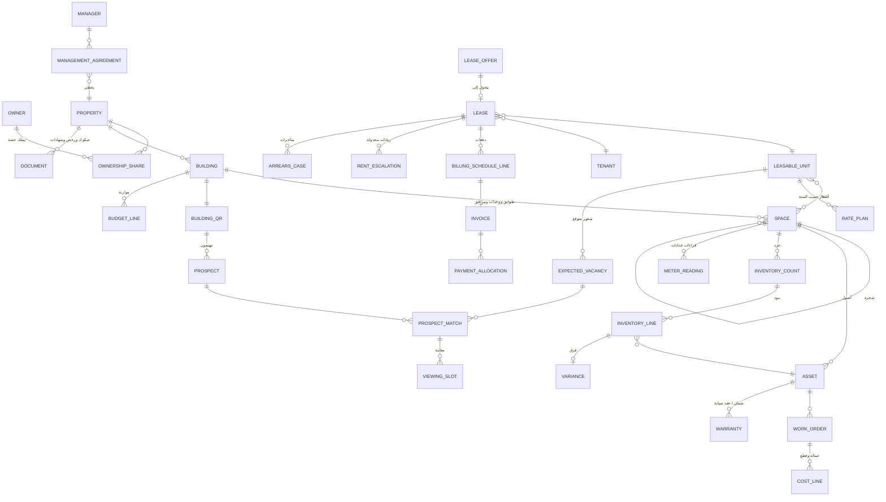

# وثيقة شروط التأسيس — منصة إدارة الأصول العقارية

> **الإصدار:** 0.8 (مسودة تأسيسية — بعد دمج تحليل المنافسين وحسم السوق الأول والبنية التقنية ووحدة الإعدادات ودروس الربط مع إيجار وإطار العمل والفحص المسبق وحزمة Claude Code وبيئة التطوير على Windows) · **التاريخ:** 22 نوفمبر 2026 · **السوق المستهدف:** المملكة العربية السعودية أولاً، ثم الخليج · **العميل الأول:** مكاتب إدارة الأملاك، والملاك المؤسسيون ذوو الأصول والمرافق الكثيرة
>
> هذه الوثيقة هي المرجع الذي يُبنى عليه كل شيء لاحقاً: نموذج البيانات، الوحدات البرمجية، الامتثال، وخارطة الطريق. أي قرار يخالفها يُوثَّق في قسم «سجل القرارات» في آخرها.

---

## 1. الفكرة في سطرين

منصة سحابية واحدة تجمع **إدارة التأجير** + **إدارة الأصول والصيانة (CMMS)** + **بوابات للمالك والمدير والمستأجر** + **محاسبة وفوترة متوافقة مع زاتكا وإيجار**، مع ميزة حصرية: **باركود لكل مبنى** يحوّل واجهة المبنى نفسها إلى قناة استقطاب للمستأجرين المهتمين.

**المشكلة التي نحلها:** المالك الذي يملك مبنى فيه شقق ومحلات لا يعرف بدقة نسبة إشغاله، ولا كم صُرف على صيانته فعلياً، ولا كم يأخذ مدير الأملاك منه. والمدير يدير ذلك عبر Excel وواتساب. والمستأجر لا يعرف إلى من يتوجه عند العطل.

### 1.1 الرسالة التسويقية

**الفكرة المحورية:** المنافسون يديرون العقد، ونحن ندير الوحدة كاملة: ما فيها، وحالته، ومن سكنها، وكم أدرّت وكم كلّفت.

شعارات مقترحة (يُختار واحد):
1. «كل وحدة، بكل ما فيها.»
2. «من المفتاح إلى كشف الحساب.»
3. «عقارك واضح من الداخل.»

ثلاثة وعود للصفحة الرئيسية:
- **تعرف ما تملك** — أصول كل وحدة مجرودة بالصورة (القسم 6.6).
- **تعرف أين ذهب مالك** — كشف يفصّل كل ريال ونسبة المدير (القسم 7.3).
- **تبقى نظامياً دون أن تتابع الأنظمة** — إيجار وزاتكا واللوائح مطبّقة آلياً (القسمان 5.7 و9).

**زاوية البيع الأقوى — مراقبة الامتثال:** نقدّم المنتج كأداة تراقب يومياً أي عقد خرج عن التطابق بين إيجار وزاتكا والبنك (التسوية الليلية، 9.3)، لا كأداة إدخال بيانات فقط. هذه القيمة هي ما يُبقي العميل مشتركاً.

**حجة العائد للمكاتب:** محفظة من 500 وحدة تولّد قرابة 40 توثيقاً و30 تجديداً في إيجار شهرياً، كل واحد منها جلسة يدوية بعدة خطوات (رقم تقديري من مصدر غير رسمي، يُستخدم للتوضيح). النظام يجهّز بياناتها ويتابعها حتى التوثيق.

---

## 2. دراسة السوق والمنافسين

### 2.1 المنافسون المحليون

**بعد حسم السوق الأول (القرار 1):** منافسونا الأساسيون هم **Property Net** (عمق المحاسبة للمكاتب)، و**منجز** (عمق الأصول والمرافق للملاك المؤسسيين)، و**ممرات**. أما عقار فلو وخطوة إنجاز فيخدمان المالك الصغير، وهو ليس هدفنا عند الإطلاق.

| المنصة | نقاط القوة | الفجوات التي نستهدفها |
|---|---|---|
| **ممرات (Mamarat)** — نايلام سوليوشنز / SpaceFlex | لوحة تحكم، تطبيق وكلاء، تطبيق مقيمين (عقود، فواتير، صيانة)، CRM وعملاء محتملون، خدمات ما بعد البيع للمطورين، سكن العمال. باقات (كما تظهر مستقرة على موقعهم في 20 نوفمبر 2026): **333 / 1,250 / 2,500 ريال شهرياً** لـ 150 / 500 / 1,000 وحدة. ملاحظة: الأسعار تُعرض بعدّاد متحرك يبدأ بأرقام أقل، فيُقرأ خطأً إن التُقط قبل استقراره. الموقع مبني على WordPress + Elementor | الصيانة متاحة فقط من الباقة الثانية؛ تطبيق المستأجر المخصص فقط في باقة الشركات؛ لا يظهر سجل أصول تفصيلي للوحدة؛ لا إيجار قصير المدى واضح؛ لا ذكر صريح لربط إيجار وزاتكا في الصفحة الرئيسية |
| **سمات (Simaat)** | تُقدَّم كأكبر منصة إدارة أملاك سعودية، ولديها اتفاقية ربط تقني مع إيجار | منصة ناضجة لكنها تستهدف المكاتب؛ الصيانة وسجل الأصول ليست محورها |
| **رغدان — أملاك** | إدارة عقارات ووحدات ومستأجرين، بوابة مستأجر، نظام صيانة يسجل فيه مزودون خارجيون، 5 تقارير مالية، قراءة بيانات إيجار | تقرأ بيانات إيجار ولا تعدّل العقود؛ النظام جزء من منصة وساطة أكبر |
| **أملاكي (Amlaki — المنتج المدرج على G2 وProduct Hunt)** | واجهة عربية أصلية، ربط إيجار، تقويم هجري/ميلادي، توزيع الدفعات FIFO، تذكير واتساب، خطة مجانية حتى 20 وحدة | منتج ناشئ، قاعدة مستخدمين صغيرة. **يختلف عن amlaaki.com** (الصف التالي) رغم تشابه الاسم — يُتحقق من الفصل بينهما |
| **أملاكي — amlaaki.com** (النظم المالية لتقنية المعلومات، جدة) | نسختان: مبسطة لغير المحاسبين ومتقدمة للشركات؛ محاسبة عامة كاملة (شجرة حسابات، أصول ثابتة وإهلاك، شيكات، مراكز تكلفة، إقفال سنة)؛ بيع نقدي وتقسيط وحجز وحدات؛ عقود صيانة؛ مستخدمون غير محدودين؛ بوابة مالك تظهر عمولة الشركة؛ **صفحة تسويق بعلامة العميل تنشر الوحدات الشاغرة تلقائياً وتخفيها عند تأجيرها**؛ تطبيق جوال؛ APIs. علامة مسجلة منذ 1437هـ، فروع في الرياض وجدة والدمام | بنية قديمة (PHP + jQuery 2.2) وتجربة استخدام مؤرّخة؛ لا ذكاء اصطناعي؛ لا ذكر لربط إيجار؛ لا صيانة بمستوى CMMS؛ صفحة الشواغر تعرض الحالي فقط لا ما سيشغر؛ الأسعار غير معلنة |
| **عقار فلو (Aqar Flow)** — aqarflow.app | **استيراد عقد إيجار (PDF) بالذكاء الاصطناعي** مع جدول الدفعات والزيادات؛ عرض تأجير يمر بمحرك اعتمادات متعدد المراحل حسب الدور؛ تذكير واتساب مع **تصعيد للمدير العام**؛ مؤشر الإجراء القضائي؛ مهام متكررة (زيارات، تجديدات، فحوصات)؛ مستندات بسجل تدقيق؛ دفتر مدفوعات بمطابقة؛ **ربط Odoo عميق** (ترحيل الدفعات والمصروفات كفواتير)؛ **النظام كامل على الجوال للمدير**. أسعار معلنة: مجاني (10 وحدات) / 49 / 99 / 199 ريال شهرياً، تجربة 30 يوماً بلا بطاقة. React (Vite) خلف Cloudflare | لا سجل أصول ولا صيانة وقائية حقيقية؛ لا كشف حساب مالك بمحاسبة أمانات ظاهرة؛ بوابة المستأجر محجوبة عن الباقات الصغرى؛ لا قائمة انتظار؛ التسعير لكل مستخدم في الباقات العليا |
| **خطوة إنجاز** — anjazstep.com | بساطة؛ سعر واحد بلا حدود (99 ريال شهرياً أو 999 سنوياً)؛ **استيراد ذكي من PDF والصور وملفات Excel** يوزّع المستأجرين على عقاراتهم؛ أقساط مع الدفع الجزئي؛ سندات قبض وصرف بشعار المنشأة؛ تذكير واتساب بضغطة؛ دعم داخل التطبيق بإرفاق صورة. صفحة HTML ثابتة، والتطبيق على `/app/` | مشروع ناشئ صغير (بريد تواصل على Gmail)؛ لا صيانة، ولا ربط إيجار أو زاتكا، ولا بوابة مالك أو مستأجر، ولا أصول |
| **Property Net** — propertynet.co | أنضج نظام مؤسسي محلي: مسار مبيعات وعروض أسعار؛ قوالب عقود تشمل أتعاب الوساطة؛ عقد واحد لعدة وحدات؛ إخلاء وتجديد بموافقة؛ الديون المجمّدة؛ **فترات ضريبية وإقرار ضريبي بضغطة**؛ زاتكا المرحلتان؛ موازنات مقابل فعلي؛ إقفال سنة وإطفاء؛ IFRS؛ **موافقة مزدوجة (maker/checker)**؛ مصادقة ثنائية؛ تطبيقات مالك ومستأجر وفني؛ اتفاقيات وساطة وفق قواعد إيجار؛ إدارة الصكوك؛ **أنواع وحدات واسعة** (لوحات إعلانية، صرّافات، أكشاك، مواقف، أراضٍ، مستودعات، مساحات مفتوحة)؛ استضافة داخل المملكة. Nuxt (Vue) | ثقيل ومغلق خلف عرض توضيحي؛ الأسعار غير معلنة؛ الموقع يفتح بالإنجليزية افتراضياً؛ لا ذكاء اصطناعي؛ لا سجل أصول (يكتفي بتكاليف الصيانة)؛ لا يخدم المالك الفرد؛ لا قائمة انتظار |
| **منجز كونكت (Munjz Connect)** — munjz.com | إدارة مرافق (CAFM) مع إدارة عقارات (PMS) لقطاعات متعددة؛ أوامر عمل تصحيحية ووقائية؛ **سجل أصول ومعدات بدورة حياة وضمانات وتكاليف**؛ مخزون قطع غيار متعدد المواقع؛ موردون ومقاولون؛ عمالة وساعات؛ ربط قيود وSAP وOdoo؛ تطبيق مقيمين؛ تحليلات تنبؤية بالذكاء الاصطناعي؛ إنترنت الأشياء؛ API مفتوح وWebhooks؛ سحابة سعودية. يدّعي 500+ شركة. WordPress + Elementor | مبني للمرافق أولاً، فالتأجير وإيجار وكشف حساب المالك أضعف؛ التسعير لكل مستخدم سنوياً وبالطلب؛ **الأصول والمخزون الكاملة في باقة Pro فقط**؛ أخطاء نصية ظاهرة في الموقع |
| **قيود (Qoyod) + مساكن** | محاسبة سحابية، حسابات أمانات الملاك، كشف حساب شهري لكل مالك، فاتورة إلكترونية، منصة «مساكن» لاتحادات الملاك | برنامج محاسبي وليس منصة تشغيل؛ لا صيانة ولا CMMS — **فرصة تكامل لا منافسة** |
| **PropGOTO (Property Automate)** | حصلت على موافقة الربط مع إيجار (فبراير 2025)، تطبيق مستأجر | تركيز على الشركات الكبيرة |
| **أودو / دفترة** | أنظمة ERP عامة فيها وحدة تأجير | ليست مصممة لنموذج المالك ← المدير ← المستأجر السعودي |

### 2.2 المرجعيات العالمية (نأخذ منها أفضل الممارسات)

**AppFolio، Buildium، Yardi، Entrata** — القاسم المشترك الذي أصبح «حداً أدنى» في السوق العالمي:
- بوابة مستأجر: دفع، طلبات صيانة، تواصل.
- بوابة مالك: قوائم مالية، تقارير أداء، مستندات.
- أوامر عمل تنتقل من البلاغ إلى المورّد إلى الإغلاق، ثم **تتحول إلى فاتورة مصروف تلقائياً**.
- محاسبة أمانات (Trust Accounting) مع توزيع آلي لصافي مستحقات المالك.
- ذكاء اصطناعي لفرز البلاغات والرد على المهتمين.

### 2.3 خلاصة الفرص (موقعنا في السوق)

1. **الصيانة + سجل الأصول في كل الباقات** — المنافسون يجعلونها ميزة مدفوعة إضافية.
2. **شفافية نسبة المدير للمالك** — لا أحد يعرضها كميزة صريحة.
3. **تعدد الملاك والورثة بحصص** — المباني الموروثة شائعة في السعودية ولا يخدمها أحد بوضوح.
4. **الإيجار المرن في المبنى نفسه** (يومي حتى سنوات) — المنافسون يفصلون بين السكن طويل الأمد والضيافة.
5. **باركود المبنى وقائمة الانتظار وموعد الشغور المتوقع** — ميزة غير موجودة في أي منصة رصدناها. أقرب ما وُجد صفحة أملاكي (amlaaki.com) التي تعرض الشواغر الحالية فقط؛ والبقية يتابعون انتهاء العقود داخلياً دون تحويلها إلى طلب جاهز قبل الشغور (التفاصيل في 8.5).
6. **محضر استلام وتسليم مرتبط بسجل الأصول** — يقلل نزاعات التأمين عند الخروج.
7. **جرد الأصول الدوري للوحدات** — لا يقدّمه أي منافس؛ الوحيد الذي يملك سجل أصول (منجز) يضعه في أعلى باقاته ولا يربطه بالجرد ولا بالتأمين (التفاصيل في 6.6).
8. **تطبيق الأنظمة السعودية آلياً** — تجميد إيجارات الرياض، تقارير لائحة إدارة الأملاك، تراخيص الضيافة والإعلان: لا أحد يطبّقها داخل النظام.
9. **أسعار معلنة ومستخدمون غير محدودين** — Property Net وأملاكي ومنجز يخفون الأسعار، ومنجز وعقار فلو يحاسبان لكل مستخدم.

### 2.4 الحد الأدنى الذي أصبح المنافسون يقدّمونه (يجب أن نساويه)

هذه ليست ميزات تمايز، لكن غيابها يُخرجنا من المقارنة:

| الميزة | من يقدّمها | موقعها في هذه الوثيقة |
|---|---|---|
| استيراد العقود والبيانات بالذكاء الاصطناعي (PDF إيجار، Excel، صور) | عقار فلو، خطوة إنجاز | 4.5 (الخطوة 0) |
| عرض تأجير قبل العقد يمر باعتمادات | عقار فلو، Property Net، ممرات | 5.4 |
| زيادات الإيجار المجدولة داخل العقد | عقار فلو | 5.5 |
| تصعيد تذكير السداد للمدير | عقار فلو | 5.8 و10.2 |
| تطبيق جوال كامل للمدير | عقار فلو | 7.5 |
| موافقة مزدوجة على القيود المالية | Property Net | 3.1 |
| إقفال الفترة الضريبية وتقرير الإقرار | Property Net | 9.2 |
| إدارة المستندات بتواريخ انتهاء | عقار فلو، Property Net | 6.7 |
| أنواع وحدات تجارية خاصة (لوحات، صرّافات، أكشاك، مواقف، أراضٍ) | Property Net | 4.3 |
| ربط Odoo / قيود | عقار فلو، منجز | 10.2 |

---

## 3. الأطراف والأدوار

| الدور | من هو | ماذا يرى ويفعل |
|---|---|---|
| **المالك (Owner)** | فرد، أو ورثة بحصص، أو شركة | لوحة أداء، كشف حساب، الموافقة على صيانة فوق سقف محدد، رؤية نسبة المدير |
| **المالك المؤسسي (Institutional Owner)** | شركة أو مالك يملك محفظة كبيرة من المباني والمرافق ويديرها بفريقه الخاص | يعمل بعقد إدارة «ذاتي» (3.1)، فلا يحتاج محاسبة أمانات بين ملاك متعددين؛ يحتاج الصيانة الوقائية، والجرد، والموردين، والموازنات، والضمانات، وصلاحيات فريقه. يقابل باقة «شركة» في التسعير |
| **مدير الأصل (Asset/Property Manager)** | المالك نفسه، أو مفوَّض منه، أو شركة إدارة أملاك | كل شيء تشغيلي ضمن الصلاحيات الممنوحة له في عقد الإدارة |
| **موظفو المدير** | محاسب، مسؤول تأجير، مشرف صيانة | صلاحيات حسب الدور |
| **فني / فريق صيانة** | داخلي أو مورّد خارجي | أوامر العمل المسندة إليه فقط، عبر تطبيق جوال |
| **المستأجر (Tenant)** | فرد أو منشأة | وحدته، عقده، فواتيره، الأصول المسجلة على وحدته، طلبات الصيانة |
| **المهتم (Prospect)** | أي شخص مسح باركود المبنى | الوحدات المتاحة أو التي ستشغر، والتسجيل في قائمة الانتظار |
| **مدير المنصة (Platform Admin)** | نحن | إدارة المشتركين والباقات وبيع لوحات الباركود |

### 3.1 قاعدة الصلاحيات الأساسية

- العلاقة بين المالك والمدير تُحكم بـ **عقد إدارة** داخل النظام يحدد: العقارات المشمولة، نوع الأتعاب (نسبة من المحصّل / مبلغ ثابت / مختلط)، **سقف الصرف** دون موافقة المالك، ومن يحق له تحصيل الأموال.
- إذا كان المالك هو المدير، يُنشأ عقد إدارة «ذاتي» بأتعاب صفر — حتى يبقى المنطق واحداً.
- كل إجراء مالي يُسجَّل في **سجل تدقيق** لا يُحذف (من، ماذا، متى، القيمة قبل وبعد).
- **الموافقة المزدوجة (المُدخِل والمراجِع):** القيود المالية الحساسة — إلغاء فاتورة، خصم أو إعفاء، تعديل دفعة مسجلة، صرف من حساب أمانات الملاك، رد التأمين — يُدخلها مستخدم ويعتمدها مستخدم آخر بصلاحية أعلى. لا يعتمد أحد ما أدخله بنفسه. المكاتب الصغيرة ذات المستخدم الواحد تستطيع تعطيلها صراحةً مع بقاء التعطيل مسجلاً في سجل التدقيق.

---

## 4. نموذج البيانات — كيف يُضاف المبنى وممَّ يتكوّن

### 4.1 المبدأ الحاكم: الفصل بين «المكان» و«ما يُؤجَّر»

هذا أهم قرار تصميمي في المشروع كله. الخطأ الشائع هو جعل «الشقة» هي الشيء الذي يُؤجَّر مباشرة؛ فيصعب بعدها تأجير مبنى كامل كعقد واحد، أو تأجير فيلا ثم تقسيمها لاحقاً.

- **المساحة (Space):** شيء مادي في شجرة هرمية — مجمّع ← مبنى ← طابق ← وحدة ← غرفة.
- **الوحدة التأجيرية (Leasable Unit):** ما يُعرض للإيجار. قد تساوي مساحة واحدة (شقة)، أو تجمع عدة مساحات (المبنى كاملاً، أو طابق كامل).
- **الأصل (Asset):** معدّة أو جهاز مرتبط بأي عقدة في الشجرة (مكيف في شقة، مصعد في مبنى، مضخة في مجمّع).

### 4.2 الشجرة الهرمية

```
المحفظة (Portfolio) — مجموعة عقارات لمالك أو تحت مدير
 └── العقار (Property) — له صك ورقم عقار ورقم تسجيل عيني وعنوان وطني
      └── المبنى (Building) — قد يكون في العقار مبنى واحد أو عدة مبانٍ
           ├── الطابق (Floor)
           │    └── الوحدة (Unit) — نوع: شقة / محل / مكتب / فيلا / مستودع / غرفة / كشك / موقف / مساحة مفتوحة
           │         └── الغرفة (Room) — اختياري
           └── المرافق المشتركة (Common Area) — مدخل، مصعد، سطح، مواقف
                └── مواقع قابلة للتأجير على المرافق — لوحة إعلانية على السطح أو الواجهة، صرّاف آلي في المدخل، برج اتصالات
```

ملاحظة: الأرض الفضاء تُمثَّل عقاراً بلا مبنى، وتكون هي نفسها الوحدة التأجيرية.

### 4.3 أنواع الوحدات وخصائص كل نوع

| النوع | الخصائص الإلزامية | ملاحظات ضريبية |
|---|---|---|
| **شقة** | المساحة، عدد الغرف والحمامات، مفروشة/غير مفروشة، رقم عداد الكهرباء، حساب المياه | سكني: معفى من ضريبة القيمة المضافة |
| **فيلا** | المساحة، الأدوار، الغرف، ملحق، مسبح، حديقة | سكني: معفى |
| **محل تجاري** | المساحة، الواجهة بالمتر، النشاط المسموح، رقم رخصة بلدي | تجاري: 15% إذا كان المؤجر مسجلاً |
| **مكتب** | المساحة، مفروش/مجهز، عدد المواقف | تجاري: 15% |
| **عمارة كاملة** | وحدة تأجيرية مركّبة تجمع كل وحدات المبنى | حسب الاستخدام |
| **مستودع** | المساحة، الارتفاع، نوع الأرضية، باب تحميل، الكهرباء (ثلاثي الطور أم لا) | تجاري: 15% |
| **كشك / وحدة صغيرة** | المساحة، الموقع داخل المبنى أو المجمّع، النشاط المسموح | تجاري: 15% |
| **موقف** | الرقم، مغطى/مكشوف، مخصص/مشترك | يتبع العقد الأصلي إن أُجّر معه، وإلا تجاري |
| **لوحة إعلانية** | الأبعاد، الموقع (سطح/واجهة)، مضاءة أم لا، رقم ترخيص اللوحة من البلدية | تجاري: 15% |
| **صرّاف آلي / برج اتصالات** | الموقع، المساحة المشغولة، استهلاك الكهرباء، الجهة المستأجرة | تجاري: 15% |
| **أرض فضاء** | المساحة، الصك، الاستخدام المسموح (سكني/تجاري/زراعي) | حسب الاستخدام — **يُؤكَّد مع مستشار** |
| **مساحة مفتوحة** | المساحة، الاستخدام (فعاليات، معارض، تخزين مؤقت) | تجاري: 15% |

### 4.4 السيناريوهات التي طلبتها — كيف تُمثَّل

**أ) مبنى فيه 8 شقق و4 محلات**
```
العقار: عمارة النخيل
 └── المبنى A
      ├── الطابق الأرضي: محل 1، محل 2، محل 3، محل 4   ← 4 وحدات تأجيرية تجارية
      ├── الطابق 1: شقة 101، 102، 103، 104            ← وحدات سكنية
      └── الطابق 2: شقة 201، 202، 203، 204
```
النتيجة: 12 وحدة تأجيرية منفصلة، ويمكن **بنفس البيانات** إنشاء وحدة تأجيرية مركّبة «المبنى كاملاً» إن جاء مستأجر يريده كله. النظام يمنع تأجير المركّبة إذا كانت أي وحدة فرعية مؤجرة، والعكس.

**ب) مبنى عبارة عن فيلا**
```
العقار: فيلا الياسمين
 └── المبنى: الفيلا (طابق أرضي + أول + ملحق)
      └── وحدة واحدة: الفيلا كاملة
```

**ج) فيلا وشقق متعددة في نفس العقار**
```
العقار: مجمع الروضة
 ├── المبنى 1: فيلا المالك           ← وحدة واحدة
 └── المبنى 2: عمارة 6 شقق           ← 6 وحدات
```

**د) فلل وشقق متعددة (مجمّع سكني)**
```
العقار: مجمع الواحة
 ├── المباني 1–10: فلل ← كل فيلا وحدة
 ├── المبنى 11: عمارة 12 شقة
 └── المرافق المشتركة: مسبح، نادي، بوابة، حراسة
```

**هـ) مكاتب تجارية**
```
العقار: برج الأعمال
 └── المبنى: البرج
      ├── الطوابق 1–5: مكاتب (كل مكتب وحدة، أو الطابق كاملاً وحدة مركّبة)
      └── الأرضي: محلات
```

### 4.5 معالج إضافة المبنى (Wizard)

بدل إدخال كل وحدة يدوياً، يمر المدير بخطوات:

0. **الانتقال السريع (اختياري):** يرفع المدير ملفاته كما هي — عقود إيجار PDF، جداول Excel، صور عقود ورقية — فيبني النظام شجرة العقار والمستأجرين والعقود وجداول الدفعات والزيادات، ويعرض كل حقل مستخرج مع درجة ثقة ليراجعه قبل الحفظ. لا يُحفظ شيء دون تأكيد. هذه ميزة حد أدنى (يقدّمها عقار فلو وخطوة إنجاز)، وهي أكبر عائق أمام انتقال العميل من منافس.
1. **بيانات العقار:** الصك، رقم العقار في إيجار، العنوان الوطني، الموقع على الخريطة، المالك/الملاك وحصصهم.
2. **اختيار القالب:** «عمارة سكنية» / «عمارة مختلطة (محلات + شقق)» / «فيلا» / «مجمّع» / «برج مكاتب» / «مخصص».
3. **التوليد السريع:** عدد الطوابق، وعدد الوحدات ونوعها في كل طابق، ونمط الترقيم (101، 102… أو A1، A2…). يولّد النظام الشجرة كاملة في ثوانٍ.
4. **التعديل:** دمج وحدتين، تقسيم وحدة، تغيير نوع.
5. **الأصول الافتراضية:** لكل نوع وحدة قائمة أصول افتراضية (شقة ← مكيفات، سخان، مطبخ…) يؤكدها المدير أو يعدّلها.
6. **التسعير:** سعر لكل وحدة ولكل نوع مدة (انظر القسم 5).

### 4.6 نموذج الكيانات (مخطط مختصر)



**ملاحظة:** محضر الاستلام والتسليم (6.5) ليس كياناً مستقلاً؛ هو `INVENTORY_COUNT` من نوع «دخول» أو «خروج»، فلا يُبنى له منطق منفصل.

### 4.7 قواعد بيانات صارمة من اليوم الأول

- المبالغ تُخزَّن كأعداد صحيحة بالهللة (لا أرقام عشرية) لتجنب أخطاء التقريب.
- كل تاريخ يُخزَّن ميلادياً بتوقيت UTC، ويُعرض هجرياً (تقويم أم القرى) أو ميلادياً أو كليهما حسب الإعدادات (7.6 ج).
- كل كيان يدعم **العربية والإنجليزية** في الأسماء.
- لا حذف فعلي لأي سجل مالي أو عقد — أرشفة فقط.
- كل مشترك (Tenant في معنى SaaS) معزول تماماً عن غيره على مستوى قاعدة البيانات.

---

## 5. محرك التأجير

### 5.1 مدد الإيجار المرنة

المدة تتكوّن من **وحدة زمنية** و**عدد**:

| الوحدة | أمثلة | المسار النظامي |
|---|---|---|
| يوم | يوم، 3 أيام | ضيافة سياحية — يتطلب ترخيص وزارة السياحة |
| أسبوع | أسبوع، 3 أسابيع | ضيافة سياحية |
| شهر | شهر، 6 أشهر | عقد إيجار — يوثّق في إيجار |
| سنة | سنة، 3 سنوات | عقد إيجار — يوثّق في إيجار |

**القاعدة:** لكل وحدة تأجيرية علَم يحدد المسارات المسموحة لها (طويل فقط / قصير فقط / الاثنان). لا تُفتح وحدة للتأجير اليومي إلا إذا أُدخل رقم ترخيص الضيافة السارٍ وتاريخ انتهائه.

### 5.2 خطط التسعير (Rate Plans)

لكل وحدة أسعار مختلفة حسب المدة: سعر اليوم ≠ سعر الشهر ÷ 30. مثال: شقة 101 — يوم 350، أسبوع 2,000، شهر 6,000، سنة 60,000.

### 5.3 تقويم الإتاحة

- عرض شبكي لكل وحدات المبنى على محور زمني (كما في أنظمة الفنادق).
- منع التداخل: لا يُنشأ عقد أو حجز يتعارض مع آخر.
- يظهر فيه: مؤجر، شاغر، محجوز مبدئياً، تحت الصيانة، **سيشغر خلال X يوم** — مع درجة الثقة (مؤكد / مرجّح / محتمل) كما في 8.5.

### 5.4 دورة حياة العقد (State Machine)

```
عرض تأجير ← (اعتمادات داخلية) ← مقبول من المستأجر
   ← مسودة ← مرسل للتوثيق ← بانتظار موافقة الأطراف ← موثّق ← ساري
   ← (إشعار عدم تجديد) ← منتهٍ / مُجدَّد ← مخالصة وإغلاق
```

- **عرض التأجير:** قبل المسودة، يُنشئ مسؤول التأجير عرضاً (الوحدة، المدة، السعر، جدول الدفعات، التأمين، الزيادات) يمر على خطوات اعتماد يحددها المدير حسب الأدوار وحسب قيمة الخصم عن السعر المعلن، ثم يُرسل للمستأجر رابطاً يقبله. العرض المقبول يتحول إلى مسودة عقد ببياناته كاملة دون إعادة إدخال. العرض المرفوض أو المنتهي يبقى مؤرشفاً لتحليل أسباب خسارة المستأجرين.
- **لا تصدر فواتير إيجار إلا لعقد في حالة «موثّق» أو «ساري».**
- عقد الإيجار الموثّق في منصة إيجار هو المرجع النظامي؛ نظامنا يحمل البيانات التشغيلية حوله ويحفظ رقم عقد إيجار كمفتاح ربط.

### 5.5 جدولة الدفعات

- منفصلة عن مدة العقد: عقد سنتين بدفعات شهرية، أو ربع سنوية، أو نصف سنوية، أو دفعة واحدة.
- توزيع المدفوعات على المستحقات بالأقدم أولاً (FIFO) افتراضياً.
- التأمين (الضمان) يُسجَّل **التزاماً** وليس إيراداً، ويُسترد عند المخالصة بعد خصم الأضرار الموثقة.
- **زيادات الإيجار المجدولة:** للعقد بنود زيادة (نسبة أو مبلغ، تبدأ من تاريخ أو من سنة محددة في العقد). يولّد النظام جدول الدفعات بعد الزيادة تلقائياً، ويُستخرج البند من عقد إيجار عند الاستيراد. **قيد نظامي:** قبل تفعيل أي زيادة، يُراجع جدول السياسات (5.7)؛ إن كانت الوحدة داخل نطاق تجميد ساري (مثل الرياض حتى سبتمبر 2030) يُوقَف البند ويظهر للمدير سبب الإيقاف.

### 5.6 التجديد ومعرفة «من سيستمر ومن سيغادر»

- **قاعدة التجديد التلقائي:** العقود تتجدد تلقائياً ما لم يُشعر أحد الطرفين الآخر كتابياً قبل 60 يوماً من الانتهاء. لذلك التنبيهات تُبنى على **موعد الإشعار** لا موعد الانتهاء.
- **استطلاع نية التجديد:** قبل 90 يوماً من الانتهاء (أي قبل مهلة الإشعار بشهر)، يصل المستأجر سؤال في بوابته: سأجدد / سأغادر / لم أقرر.
- **مؤشر احتمال المغادرة** لكل مستأجر يُحسب من: رد الاستطلاع، انتظام السداد، عدد البلاغات المفتوحة وتقييمه لحلها، مدة الإقامة.
- **لوحة التجديدات:** قائمة بالعقود المنتهية خلال 30/60/90/180 يوماً، مصنفة حسب نية المستأجر.
- **أسباب عدم التجديد** تُحفظ كرمز مع مستند داعم (في الرياض تحديداً، لا يحق للمؤجر رفض التجديد إلا لأسباب محددة). رموز الرياض المبدئية: عدم سداد المستأجر، عيوب إنشائية مثبتة بتقرير فني، سكن المالك أو قريب من الدرجة الأولى، وحالات أخرى تحددها الهيئة. تُخزَّن في جدول السياسات (5.7) لا في الكود، **وتُطابَق مع النص الرسمي قبل الإطلاق**. الرفض بلا رمز ومستند يمنعه النظام.

### 5.7 قواعد السياسات الإقليمية (جدول قابل للتحديث)

لا تُبرمج القواعد النظامية داخل الكود. تُخزَّن في جدول سياسات مرتبط بالمنطقة وتاريخ السريان، لأن الأنظمة تتغير.

**مثال حالي — الرياض:** إيقاف الزيادة في إيجارات العقارات السكنية والتجارية داخل النطاق العمراني لخمس سنوات من 25 سبتمبر 2025 حتى سبتمبر 2030، وتثبيت إيجار الوحدة الشاغرة على آخر عقد مسجل. النظام يجب أن:
- يمنع إدخال سعر تجديد أعلى من آخر سعر مسجل للوحدة داخل النطاق.
- يحفظ «آخر إيجار مسجل» لكل وحدة كحقل إلزامي.
- يسمح للهيئة بتمديد القاعدة لمدن أخرى بإضافة صف جديد في الجدول دون تعديل برمجي.
- يوقف بنود الزيادة المجدولة (5.5) داخل النطاق، **في العقود القائمة والجديدة معاً** كما ينص القرار الرسمي.
- يمنع أن يتجاوز إيجار التأجير من الباطن إيجار العقد الأصلي.

**تنبيه:** بعض المقالات غير الرسمية تذكر أن بنود الزيادة في العقود القائمة قبل 25 سبتمبر 2025 تبقى سارية. هذا يخالف النص المنشور في أم القرى («لا يُمكن للمُؤجِر أنْ يزيدَ قيمة الأجرة الإجمالية… في العقود القائمة أو الجديدة»). المرجع دائماً النص الرسمي. كذلك يختلف مقدار الغرامات بين المصادر، فلا يُستخدم رقم في التسويق قبل التحقق منه رسمياً.

**رسوم إيجار:** رسوم التسجيل والتوثيق تُفرض على المؤجر عن كل عقد، ومبالغها تتغيّر من وقت لآخر. تُحفظ في جدول السياسات **بتاريخ سريان**، وتُراجع مع الصفحات الرسمية لإيجار قبل كل دورة، ولا تُكتب في الكود.

### 5.8 مسار المتأخرات

سلّم متدرّج يُضبط لكل مدير، ويُفتح له «ملف متأخرات» (`ARREARS_CASE`) لكل عقد متعثر:

1. تذكير قبل الاستحقاق ويوم الاستحقاق (واتساب + بوابة).
2. تذكير ثانٍ بعد 7 أيام، مع **تصعيد تلقائي للمدير** (وللمالك إن تجاوز سقفاً يحدده).
3. إنذار رسمي مكتوب بنموذج معتمد بعد 30 يوماً.
4. **ملف مطالبة جاهز:** العقد الموثّق، كشف المتأخرات بالتواريخ، الفواتير، سجل كل تواصل وإنذار، يُصدَّر PDF للمحامي أو للمنصات العدلية.

يظهر في لوحة المدير مؤشر «قيد الإجراء القضائي» للعقود التي وصلت المرحلة 4. صياغة الإنذار والمستندات المطلوبة **تُؤكَّد مع محامٍ**.

---

## 6. إدارة الأصول والصيانة (CMMS)

### 6.1 سجل الأصول

لكل أصل: الرمز (QR داخلي)، النوع، الماركة، الموديل، الرقم التسلسلي، تاريخ التركيب، الضمان وتاريخ انتهائه، الموقع في الشجرة، الحالة (1–5)، التكلفة، العمر الافتراضي، الصور.

**تصنيف موحّد للأصول** (Taxonomy) — نعتمد تصنيفاً مبسطاً من معايير مثل Uniformat:
- تكييف وتهوية (HVAC) ← مكيف شباك، سبليت، مركزي، مراوح شفط
- سباكة ← سخانات، مضخات، خزانات، فلاتر
- كهرباء ← لوحات، مولد، إنارة
- سلامة ← طفايات، إنذار حريق، رشاشات، كاميرات
- نقل رأسي ← مصاعد
- أجهزة ← مطبخ، غسالة، ثلاجة (للمفروش)
- إنشائي ← أبواب، نوافذ، عزل، دهانات

**الضمانات وعقود الصيانة السنوية:** لكل أصل ضمان المصنّع أو المورّد، ولكل مبنى عقود الصيانة السنوية (مصاعد، تكييف مركزي، مكافحة حشرات). ينبّه النظام قبل انتهاء الضمان أو العقد بـ 30 يوماً، و**يوجّه البلاغ على أصل ضمانه ساري إلى المورّد الضامن** بدل فني مدفوع، مع متابعة المطالبة حتى الإغلاق.

### 6.2 أنواع الصيانة

| النوع | المصدر | مثال |
|---|---|---|
| **تصحيحية** | بلاغ مستأجر أو مشرف | تسريب مياه |
| **وقائية مجدولة (PPM)** | جدول زمني تلقائي | تنظيف فلاتر المكيفات كل 3 أشهر |
| **نظامية** | التزام قانوني — يُنشأ أمر العمل تلقائياً قبل انتهاء الشهادة المرتبطة في خزنة المستندات (6.7) | فحص أنظمة الحريق والدفاع المدني، صيانة المصاعد |
| **تجهيز الوحدة** | خروج مستأجر | دهان وتنظيف وفحص قبل التأجير التالي |
| **طارئة** | بلاغ بأولوية قصوى | انقطاع كهرباء، تسريب غاز |

### 6.3 دورة أمر العمل

```
بلاغ (مع صور) ← فرز وتحديد الأولوية ← تقدير التكلفة
   ← [إن تجاوز سقف المدير: موافقة المالك]
   ← إسناد (فني داخلي / مورّد) ← قيد التنفيذ ← منجز (صور قبل/بعد)
   ← تأكيد المستأجر وتقييمه ← إغلاق ← تحويل التكلفة إلى قيد محاسبي
```

### 6.4 أفضل الممارسات المطبّقة

- **اتفاقيات مستوى الخدمة (SLA) حسب الأولوية:** طارئ (استجابة خلال ساعتين)، عاجل (24 ساعة)، عادي (72 ساعة)، مجدول. النظام يحسب نسبة الالتزام لكل فني ومورّد.
- **تحميل التكلفة على المتسبب:** إذا كان العطل بسبب سوء استخدام المستأجر، تتحول التكلفة إلى فاتورة عليه بموافقة موثقة.
- **سجل كامل لكل أصل:** كل أوامر العمل عليه وتكلفتها التراكمية ← يكشف «الأصل الذي يجب استبداله بدل إصلاحه».
- **إدارة قطع الغيار:** مخزون بسيط لكل مدير، يُخصم تلقائياً عند استخدامه في أمر عمل.
- **إدارة الموردين:** ملف المورّد، سجله التجاري، تقييمه، أسعاره المتفق عليها، فواتيره.
- **تطبيق الفني:** يعمل دون إنترنت في البدرومات ثم يزامن؛ يمسح QR الأصل فيفتح سجله.
- **المرجعية المعيارية:** ISO 55000 لإدارة الأصول، وISO 41001 لإدارة المرافق — نسترشد بمبادئهما ولا نلتزم بشهادة في البداية.

### 6.5 محضر الاستلام والتسليم (ميزة تمايز)

عند دخول المستأجر: جولة رقمية على كل أصول الوحدة، حالة كل أصل وصورته، توقيع المستأجر إلكترونياً. وعند الخروج: الجولة نفسها ومقارنة آلية. الفروقات تتحول إلى خصم من التأمين بمستند واضح — وهذا أكبر مصدر للنزاعات في السوق.

المحضر هو جرد من نوع «دخول» أو «خروج» ضمن آلية الجرد في 6.6، ويستخدم الكيانات نفسها.

### 6.6 جرد الأصول (ميزة تمايز)

**الغرض:** أن يعرف المالك والمدير، في أي يوم، ما الموجود فعلاً في كل وحدة وما حالته — لا ما سُجّل مرة واحدة عند الإضافة. لم نجد هذه الميزة عند أي منافس.

**أنواع الجرد:**

| النوع | متى | من ينفّذ | النتيجة |
|---|---|---|---|
| جرد التأسيس | عند إضافة المبنى | المدير أو الفني | سجل الأصول المرجعي لكل وحدة |
| جرد الدخول | قبل تسليم المفتاح | المدير + المستأجر | محضر موقّع من الطرفين (6.5) |
| الجرد الدوري | كل 6 أو 12 شهراً حسب الإعداد | الفني، بموعد مسبق مع المستأجر | تقرير فروقات + أوامر عمل تلقائية |
| جرد الخروج | عند المخالصة | المدير + المستأجر | مقارنة آلية بجرد الدخول ← خصم موثّق من التأمين |
| جرد مفاجئ | بطلب المالك أو بعد حادث (تسرّب، حريق) | المدير | تقرير أضرار صالح لمطالبة التأمين |
| جرد المرافق المشتركة | ربع سنوي | الفني | حالة المصاعد والمضخات والمولدات ومعدات السلامة |

**كيف يعمل الجرد في الميدان:**

1. يفتح الفني مهمة الجرد في تطبيقه، فتظهر قائمة الأصول المتوقّعة في الوحدة.
2. يمسح ملصق QR على كل أصل (أو يختاره من القائمة إن لم يكن مُلصَقاً).
3. يسجّل لكل أصل: موجود / غير موجود، الحالة من 1 إلى 5، صورة إلزامية، وملاحظة اختيارية.
4. يضيف أي أصل وجده وليس مسجّلاً.
5. يوقّع الفني، ويوقّع المستأجر إن كان حاضراً. يعمل كل ذلك دون اتصال ثم يزامن.

**تصنيف الفروقات وما يحدث بعدها:**

| الفرق | الإجراء التلقائي |
|---|---|
| مفقود | تنبيه للمدير والمالك، واقتراح تحميل القيمة على المستأجر بموافقة موثّقة |
| تالف أو انخفاض الحالة درجتين فأكثر | أمر عمل صيانة، أو مطالبة ضمان إن كان الضمان سارياً |
| منقول من وحدة أخرى | تحديث موقع الأصل في الشجرة مع قيد في سجل التدقيق |
| زائد غير مسجّل | إضافته للسجل بعد اعتماد المدير |
| انتهى عمره الافتراضي | إدراجه في توقّعات الاستبدال للسنة القادمة |

**التقارير:** نسبة اكتمال الجرد لكل مبنى، منحنى حالة الأصول عبر الزمن، قيمة المفقودات السنوية، وميزانية استبدال مقترحة للمالك.

**الكيانات:** `INVENTORY_COUNT` (النوع، الوحدة، التاريخ، المنفّذ، التوقيعات) ← `INVENTORY_LINE` (الأصل، الحالة، الصورة) ← `VARIANCE` (نوع الفرق، الإجراء، القيمة).

**فرصة دخل:** بيع ملصقات QR مقاومة للأصول ضمن الإضافات، بجانب لوحات المباني (8.2).

### 6.7 خزنة المستندات والامتثال

لكل عقار ومبنى ووحدة ملف مستندات مصنّف، ولكل مستند تاريخ انتهاء إن وُجد:

- **ملكية:** الصك، رقم التسجيل العيني، الوكالات الشرعية للمدير.
- **رخص:** رخصة البناء، الرخص البلدية للمحلات، رخص اللوحات الإعلانية، تراخيص الضيافة (9.5)، تراخيص الإعلان العقاري (8.3).
- **شهادات نظامية:** الدفاع المدني، فحص المصاعد، وثيقة تأمين المبنى.
- **أطراف:** هويات الملاك والمستأجرين وسجلاتهم التجارية (بصلاحيات وصول مقيّدة وفق نظام حماية البيانات).

ينبّه النظام قبل انتهاء أي مستند بـ 30 و7 أيام، ويُنشئ أمر الصيانة النظامية المرتبط تلقائياً (6.2). كل مستند بسجل مراجعة: من رفعه، ومن اطّلع عليه، ونسخه السابقة.

---

## 7. البوابات والواجهات

**تطبيق واحد لا عدة تطبيقات:** كل البوابات التالية (المستأجر، المالك، المدير، الفني) واجهات داخل **تطبيق ويب واحد قابل للتثبيت على الجوال (PWA)**. يدخل كل مستخدم بحسابه فيرى ما تسمح به صلاحياته فقط (القسم 11). كلمة «تطبيق» في هذا القسم تعني الواجهة الخاصة بالدور داخل هذا التطبيق الواحد.

### 7.1 بوابة المستأجر (تطبيق + ويب)

- **وحدتي:** بيانات الوحدة، **الأصول المسجلة عليها** وحالتها عند الاستلام، أدلة الاستخدام.
- **عقدي:** نسخة العقد، رقمه في إيجار، تاريخ الانتهاء، موعد مهلة الإشعار.
- **فواتيري:** المستحق، المدفوع، الفواتير الضريبية الإلكترونية، الدفع (مدى، Apple Pay، سداد، بطاقات).
- **الصيانة:** فتح بلاغ (اختيار الأصل + وصف + صور/فيديو)، متابعة الحالة لحظياً، تقييم الخدمة.
- **البلاغ الصوتي (مرحلة 3):** يسجّل المستأجر بلاغه برسالة صوتية بلهجته، فيحوّلها النظام لنص ويقترح الأصل المعطّل والأولوية، ويبقى التسجيل الأصلي مرفقاً.
- **نية التجديد:** الرد على الاستطلاع، طلب تجديد أو إنهاء.
- **الإعلانات:** إشعارات من الإدارة (انقطاع مياه، صيانة مصعد).
- **خدمات إضافية (مرحلة لاحقة):** تنظيف، نقل عفش، تصاريح دخول زوار، حجز مرافق مشتركة.
- **نقل العدادات:** توجيه المستأجر لخدمة نقل عدادات الكهرباء والمياه باسمه التي توفرها منصة إيجار عند التوثيق.

### 7.2 لوحة مدير الأصل

**مؤشرات الأداء الرئيسية (KPIs) لكل مبنى وللمحفظة:**

| المؤشر | التعريف |
|---|---|
| نسبة الإشغال الفعلية | الوحدات المؤجرة ÷ إجمالي الوحدات |
| نسبة الإشغال المالية | الإيجار الفعلي ÷ الإيجار المحتمل لو أُجّر كل شيء |
| معدل التحصيل | المحصّل ÷ المستحق في الفترة |
| أعمار الذمم | متأخرات 0–30 / 31–60 / 61–90 / +90 يوم |
| متوسط مدة الشغور | أيام بين خروج مستأجر ودخول التالي |
| معدل التجديد | العقود المجددة ÷ المنتهية |
| تكلفة الصيانة | لكل وحدة / لكل متر مربع / كنسبة من الإيراد |
| الالتزام بـ SLA | أوامر العمل المنجزة في وقتها ÷ الإجمالي |
| صافي الدخل التشغيلي (NOI) | الإيرادات − مصروفات التشغيل |
| أيام الشغور المتجنَّبة | الفرق بين خروج المستأجر ودخول البديل لمن جاء من قائمة الانتظار (8.5) |
| طول قائمة الانتظار | المسجلون النشطون لكل مبنى ونوع وحدة — مؤشر طلب حقيقي |
| اكتمال الجرد | الوحدات المجرودة في موعدها ÷ المستحق جردها (6.6) |
| المصروف مقابل الموازنة | الفعلي ÷ المخطط لكل بند في المبنى |

**أقسام إضافية:**
- آخر عمليات الصيانة في المبنى وتكلفتها الفعلية (عمالة + قطع + مورّد).
- العقود التي ستنتهي، والمستأجرون المحتمل مغادرتهم.
- قائمة المهتمين المسجلين عبر باركود المبنى.
- إصدار الفواتير للمستفيد النهائي (المستأجر) — فواتير إيجار، أو فواتير صيانة محمّلة عليه، أو رسوم خدمات.
- **المستندات التي ستنتهي** (6.7) وملفات المتأخرات المفتوحة (5.8).

**سجل الوحدة:** لكل وحدة صفحة واحدة تجمع تاريخها: المستأجرون السابقون، الأصول وحالاتها عبر الجرود، أوامر العمل وتكلفتها، قراءات العدادات، والإيراد التراكمي. يُصدَّر PDF عند بيع العقار أو تغيير المدير، فينتقل تاريخ الوحدة معها.

**العدادات والاستهلاك:** قراءة شهرية لعدادات المياه والكهرباء بصورة من تطبيق الفني، وتوزيع الفاتورة المشتركة على الوحدات بالاستهلاك أو بالمساحة، مع تنبيه عند استهلاك غير طبيعي (مؤشر تسرّب). يخدم المجمّعات ذات العداد المشترك وفواتير الخدمات (يقدّمها Property Net وأملاكي جزئياً).

### 7.3 لوحة المالك

- كل مؤشرات المدير لعقاراته فقط، بلغة مبسطة.
- **كشف حساب شهري:** إجمالي الإيجار المحصّل ← ناقص أتعاب الإدارة (بنسبتها الظاهرة) ← ناقص الصيانة (مع تفصيل كل أمر عمل) ← = صافي المحوَّل له.
- **شفافية نسبة المدير:** تظهر النسبة المتفق عليها في عقد الإدارة، وأي هامش يضيفه المدير على فواتير الموردين (إن وُجد) يظهر سطراً منفصلاً. هذا شرط تصميمي لا اختياري.
- **الموافقات:** طلبات الصيانة التي تجاوزت سقف المدير تنتظر موافقته بضغطة.
- **تعدد الملاك:** إن كان العقار لورثة أو شركاء، كل منهم يرى نصيبه حسب حصته، وكشف الحساب يوزّع الصافي تلقائياً.
- إشعار المالك عند تسجيل مهتمين جدد عبر الباركود (إن كان المالك غير المدير).
- **موازنة المبنى:** يضع المالك موازنة سنوية لكل بند (صيانة، نظافة، حراسة، مرافق)، ويرى في كشفه المصروف مقابل المخطط. الصرف الذي يتجاوز الموازنة يتوقف حتى يوافق.
- **المستندات والجرود:** يطّلع على خزنة المستندات (6.7) وتقارير الجرد (6.6) لعقاراته.
- **الملخص السنوي:** تقرير نهاية السنة بإجمالي الدخل والمصروفات والأتعاب والصافي لكل عقار ولكل شريك حسب حصته، بصيغة يستلمها محاسبه مباشرة للزكاة وإعداد قوائمه.

### 7.4 تطبيق الفني

أوامر العمل المسندة، خريطة المواقع، مسح QR الأصل، تسجيل القطع والوقت، صور قبل/بعد، توقيع المستأجر، عمل دون إنترنت، **مهام الجرد** (6.6) و**قراءات العدادات** (7.2).

### 7.5 تطبيق المدير

واجهة جوال مبسّطة للمدير داخل التطبيق الواحد، للمهام اليومية (يقدّم عقار فلو النظام كاملاً على الجوال، وهذا أصبح توقعاً عند المكاتب):

- صندوق مهام موحّد: الاعتمادات المعلّقة (عروض، صرف، قيود مزدوجة)، البلاغات الجديدة، المتأخرات المصعّدة.
- تسجيل دفعة وإصدار سند قبض.
- إنشاء عرض تأجير واستيراد عقد إيجار.
- متابعة أوامر العمل وإسنادها.
- تنبيهات فورية.

تبقى لواجهة الشاشة الكبيرة (الحاسب): إعدادات المحاسبة المتقدمة، الموازنات، إعادة جدولة الدفعات، والتقارير التفصيلية.

### 7.6 الإعدادات والتخصيص

**المبدأ:** كل إعداد يعيش في مستوى واحد من أربعة، والمستوى الأدق يتغلّب على الأعم: **المستخدم ← المشترك (المكتب أو الشركة) ← المنصة**. ويستطيع مدير المشترك **قفل** إعداد ما، فلا يغيّره المستخدمون (مثل فرض المصادقة الثنائية).

| المستوى | من يغيّره | أمثلة |
|---|---|---|
| **المنصة** | نحن (مدير المنصة) | السمات الجاهزة المتاحة، الإعدادات الافتراضية لكل مشترك جديد، المزايا المتاحة لكل باقة |
| **المشترك** | مدير المكتب أو الشركة | الهوية والسمة، التاريخ في المستندات الرسمية، سياسات الإشعارات، الأمان، الأرقام التسلسلية، الإعدادات المالية والتشغيلية |
| **العقار / المبنى** | المدير | استثناءات على مستوى المبنى عند الحاجة: جدول التذكيرات، أوقات الاستجابة للصيانة، دورية الجرد |
| **المستخدم** | كل مستخدم لنفسه | الوضع الليلي، طريقة عرض التاريخ، اللغة، تفضيلات الإشعارات، حجم الخط، كثافة الجداول |

#### أ) المظهر والسمات (لتناسب عملاء كثيرين)

**السمة** مجموعة ألوان وخطوط وزوايا جاهزة، تُبنى كمتغيرات تصميم (Design Tokens) في CSS. تغيير السمة يغيّر المتغيرات فقط، فلا يُعاد بناء أي شاشة.

- **سمة المنصة الافتراضية:** الهوية التي نختارها من الخيارات الثلاثة (طين نجدي / حبر ونحاس / برقوق). الخياران الآخران يبقيان **سمتين جاهزتين** يختار منهما المشترك.
- **سمة مخصصة للمشترك:** يرفع شعاره (نسخة للوضع الفاتح وأخرى للداكن)، ويختار لونه الأساسي. يولّد النظام درجاته تلقائياً، و**يرفض اللون إن لم يحقق تباين القراءة المطلوب** مع النص، حتى لا تصبح الشاشات غير مقروءة.
- **ما لا يتغيّر بالسمة:** ألوان الحالة الخمسة (مدفوع، متأخر، شاغر، تحت الصيانة، سيشغر)، لأن معناها يجب أن يكون واحداً عند كل العملاء وفي التدريب والدعم.
- **أين تظهر هوية المشترك:** الشاشات، وصفحة الدخول، والفواتير وسندات القبض وكشوف المالك (PDF)، وصفحة المبنى (8)، واسم المرسل في الرسائل. وحين يثبّت المستأجر التطبيق على جواله، يظهر **باسم المشترك وأيقونته** لا باسمنا.
- **نطاق خاص** (مثل `portal.officename.sa`) لباقة «شركة».

**توزيع التخصيص على الباقات:**

| الباقة | التخصيص المتاح |
|---|---|
| مالك | سمة جاهزة + الشعار |
| مكتب | + لون أساسي مخصص، وهوية المستندات والرسائل |
| شركة | + هوية كاملة (White-label): نطاق خاص، وأيقونة التطبيق واسمه، وصفحة دخول بهويته |

#### ب) الوضع الليلي

- ثلاثة خيارات للمستخدم: **فاتح / داكن / تلقائي يتبع إعداد الجهاز** (الافتراضي: تلقائي).
- كل سمة، جاهزة أو مخصصة، تُعرَّف بنسختين فاتحة وداكنة، وألوان الحالة لها درجات داكنة مقروءة.
- **المستندات المطبوعة وملفات PDF فاتحة دائماً** مهما كان وضع الشاشة.
- الشعار: تُستخدم نسخة الوضع الداكن إن رُفعت، وإلا يُعرض الشعار على خلفية فاتحة صغيرة.

#### ج) التاريخ والتقويم

| الإعداد | المستوى | الخيارات | الافتراضي |
|---|---|---|---|
| عرض التاريخ في الشاشات | المستخدم | هجري / ميلادي / كلاهما (مع تحديد أيهما الأول) | كلاهما، الهجري أولاً |
| التاريخ في المستندات الرسمية (العقود، الفواتير، الكشوف) | المشترك (قابل للقفل) | هجري / ميلادي / كلاهما | كلاهما |
| التقويم الهجري المعتمد | المنصة | تقويم أم القرى | أم القرى |
| تصحيح يدوي للتاريخ الهجري | المشترك | ±1 يوم عند اختلاف الرؤية — **الآلية النهائية بانتظار المواصفات (القرار المفتوح 13)** | بلا تصحيح |
| بداية الأسبوع | المشترك | الأحد / السبت / الاثنين | الأحد |
| المنطقة الزمنية | المشترك | حسب الدولة | الرياض (+3) |

**قواعد ثابتة لا تخضع للإعداد:**
- التخزين دائماً ميلادي بتوقيت UTC (4.7)، والإعداد يغيّر **العرض** فقط.
- **الفاتورة الإلكترونية** تحمل التاريخ الميلادي كما تشترطه زاتكا، ويجوز إضافة الهجري بجانبه في النسخة المطبوعة.
- مواعيد الاستحقاق والإشعارات تُحسب على التاريخ المخزّن، فلا يتغيّر موعد بتغيّر طريقة العرض.

#### د) الإشعارات

**ثلاثة أبعاد لكل إشعار:** الحدث × القناة × المستلم.

- **القنوات:** داخل التطبيق، وإشعارات الجوال (بعد تثبيت التطبيق)، وواتساب، والرسائل النصية، والبريد الإلكتروني.
- **قائمة أحداث** يحدد المشترك لكل منها: هل هو مفعّل، وعلى أي القنوات، ولمن. أمثلة: دفعة مستحقة، دفعة متأخرة، دفعة مستلمة، عقد قارب الانتهاء، رد على استطلاع التجديد، بلاغ صيانة جديد، أمر عمل تأخر عن موعده، اعتماد ينتظرك، مستند قارب الانتهاء، مهتم جديد في قائمة الانتظار، جرد مستحق.
- **إشعارات إلزامية** يقفلها المشترك فلا يعطّلها المستخدم، مثل: البلاغات الطارئة، والتنبيهات الأمنية (دخول من جهاز جديد).
- **ساعات الهدوء:** لا تُرسل رسائل واتساب أو نصية للمستأجرين بين 10 مساءً و8 صباحاً (قابلة للتعديل)، إلا للطوارئ.
- **الملخص اليومي:** خيار للمدير والمالك بدل عشرات الإشعارات المتفرقة: رسالة واحدة صباحية بما يحتاج انتباهه.
- **سلّم التصعيد:** إن لم يُتخذ إجراء خلال مدة محددة، ينتقل الإشعار للمستوى الأعلى (مثل المتأخرات في 5.8).
- **قوالب الرسائل:** يعدّل المشترك نصوصها بمتغيرات (اسم المستأجر، الوحدة، المبلغ، الموعد)، وبلغة المستلم. **قيد:** قوالب واتساب تحتاج اعتماد Meta قبل استخدامها.
- **عدّاد الاستهلاك:** يرى المشترك عدد رسائل واتساب والرسائل النصية المستهلكة من حصة باقته، قبل أن تُحتسب عليه رسائل إضافية.

#### هـ) اللغة والأرقام والعملة

- لغة الواجهة لكل مستخدم: العربية / الإنجليزية. ولغة الرسائل لكل مستأجر حسب ما يختاره.
- شكل الأرقام: غربية (1، 2، 3) أو عربية مشرقية (١، ٢، ٣). الافتراضي غربية في الجداول المالية.
- عرض العملة: رمز الريال الجديد (﷼) أو «ر.س». ودعم عملات الخليج عند التوسع.

#### و) إعدادات المشترك التشغيلية والمالية

| المجموعة | الإعدادات | الافتراضي |
|---|---|---|
| **المالية** | بداية السنة المالية، التسجيل الضريبي ونسبته، الفترة الضريبية (شهرية/ربع سنوية)، أنماط الترقيم للعقود والفواتير والسندات، قوالب المستندات | يناير، ربع سنوية |
| **التأجير** | مهلة إشعار عدم التجديد، موعد استطلاع نية التجديد، التأمين الافتراضي، جدول تذكيرات السداد | 60 يوماً، 90 يوماً قبل الانتهاء |
| **الصيانة** | أوقات الاستجابة لكل أولوية، سقف الصرف دون موافقة المالك، دورية الجرد | ساعتان / 24 / 72 ساعة؛ القرار المفتوح 9 للجرد |
| **قائمة الانتظار** | دورية تأكيد الاهتمام، عرض درجة «مرجّح» للعموم أم للمسجلين فقط | 60 يوماً؛ القرار المفتوح 8 |
| **الأمان** | فرض المصادقة الثنائية، مدة الجلسة، سياسة كلمات المرور، تفعيل الموافقة المزدوجة | مفروضة للمدير والمالك؛ القرار المفتوح 10 للموافقة المزدوجة |
| **البيانات** | مدد الاحتفاظ بكل نوع بيانات (وفق نظام حماية البيانات)، التصدير الكامل (11.2) | — |
| **التكاملات** | بيانات ربط بوابة الدفع، ومزوّد الفوترة، وواتساب، وOdoo/قيود — لكل مشترك حساباته الخاصة | — |

#### ز) إمكانية الوصول (لكل مستخدم)

حجم الخط (عادي / كبير / أكبر)، وتباين عالٍ، وتقليل الحركة، وكثافة الجداول (مريحة / مضغوطة)، والصفحة التي تفتح عند الدخول.

#### ح) التنفيذ التقني

- الإعدادات في ثلاثة جداول (المنصة، المشترك، المستخدم)، وقيم كل جدول بصيغة JSONB لها مخطط تحقق ثابت. القيم الفعلية تُحسب بالوراثة وتُحفظ في Redis.
- السمات متغيرات CSS تقرأها Tailwind وFilament. Filament يدعم الوضع الداكن وتخصيص الألوان من الأساس.
- كل تغيير على إعدادات المشترك يُسجَّل في سجل التدقيق (من غيّر، وماذا، ومتى).

---

## 8. ميزة باركود المبنى وقائمة الانتظار

### 8.1 الفكرة

لوحة على واجهة المبنى عليها رمز QR. أي مار مهتم يمسحه ← صفحة المبنى ← يرى:
- الوحدات الشاغرة الآن (النوع، المساحة، السعر).
- الوحدات **التي ستشغر** وتاريخها التقريبي (من بيانات المستأجرين الذين أبدوا نية المغادرة).
- زر «سجّلني كمهتم» ← بياناته ونوع الوحدة والميزانية والموعد المطلوب.

**الصفحة حيّة:** تتحدّث من النظام نفسه دون تدخل — الوحدة تظهر عند شغورها، وتختفي بمجرد توثيق عقدها، وتعود عند انتهائه. (أملاكي — amlaaki.com — يفعل ذلك للشواغر الحالية فقط؛ تمايزنا هو الوحدات التي **ستشغر** وقائمة الانتظار.)

### 8.2 النموذج التجاري

| المصدر | الآلية |
|---|---|
| **رسم المهتم** | رسم بسيط يحدده مدير الأصل للتسجيل في قائمة الانتظار (أو الاطلاع على موعد الشغور)، ويصل إشعار للمالك إن كان غير المدير |
| **بيع اللوحات** | نوفّر اللوحة بعدة خامات: ورقية/ملصق مقاوم، أكريليك، **معدن محفور بالليزر** (الأعلى سعراً والأطول عمراً) |
| **ملصقات الأصول** | ملصقات QR مقاومة للحرارة والرطوبة لكل أصل داخل الوحدات، تُستخدم في الجرد (6.6) والصيانة |
| **أولوية التأجير** | المسجلون في القائمة يُبلَّغون أولاً عند الشغور وفق آلية ترتيب نحددها (أسبقية التسجيل، أو مطابقة المتطلبات) |
| **اشتراك الميزة** | ميزة مضافة على الباقة لمن يريدها |

### 8.3 ⚠️ اشتراطات نظامية يجب حسمها قبل الإطلاق

هذه الميزة هي الأكثر حساسية نظامياً في المشروع، وتحتاج رأياً قانونياً مكتوباً قبل تفعيلها:

1. **اللوحة إعلان عقاري:** اللائحة التنظيمية للتسويق والإعلانات العقارية (سارية من مايو 2026) تشترط ترخيص إعلان عقاري مستقل قبل نشر أي إعلان، يطلبه وسيط أو منشأة عقارية مرخصة، وتشمل اللوحات الإعلانية والمنصات الإلكترونية. **التصميم المقترح:** صفحة المبنى تعرض رقم ترخيص الإعلان بارزاً، والنظام لا يفعّل الباركود لوحدات معروضة للإيجار إلا بعد إدخال رقم ترخيص إعلان ساري.
2. **رسم المهتم:** تقاضي رسم من الباحث عن سكن قد يُكيَّف كوساطة أو كممارسة تخضع لنظام الوساطة العقارية. يُعرض على محامٍ متخصص قبل التفعيل. بديل آمن مبدئياً: التسجيل مجاني والرسم على «خدمة إضافية» واضحة (مثل حجز مبدئي قابل للاسترداد).
3. **حماية البيانات الشخصية:** جمع بيانات المهتمين يخضع لنظام حماية البيانات الشخصية (سدايا) — موافقة صريحة، غرض محدد، مدة احتفاظ، حق الحذف، وتخزين داخل المملكة.
4. **الرياض:** الوحدة الشاغرة سعرها مثبت على آخر عقد مسجل — صفحة المبنى تعرض هذا السعر ولا تسمح بغيره.

### 8.4 مواصفات تقنية للرمز

- رابط ثابت قصير خاص بنا (مثل `oursite.sa/b/X7K2`) — لا يتغير أبداً حتى لو تغيّر المدير أو تغيّرت بيانات المبنى، لأن اللوحة المعدنية لا تُستبدل.
- تتبّع عدد المسحات ومصدرها (للتقارير وقياس العائد).
- إمكانية إيقاف الصفحة مؤقتاً دون إزالة اللوحة.

### 8.5 قائمة الانتظار وموعد الشغور — كيف تعمل فعلياً

المنافسون يعرفون متى ينتهي العقد، لكن لا أحد يحوّل هذه المعلومة إلى طلب جاهز قبل أن تفرغ الوحدة. عندهم يبدأ الشغور يوم خروج المستأجر؛ عندنا يبدأ البحث عن البديل قبل ذلك بشهرين أو ثلاثة.

**تقويم الشغور المتوقع بدرجات ثقة:**

| الدرجة | متى تُعطى | ما يراه المهتم |
|---|---|---|
| مؤكد | أُرسل إشعار عدم التجديد قبل 60 يوماً، أو طُلب الإخلاء | «متاحة من شهر X» |
| مرجّح | ردّ المستأجر على استطلاع النية (5.6) بـ«سأغادر» | «متوقع أن تتاح في شهر X» |
| محتمل | «لم أقرر» مع مؤشر مغادرة مرتفع | لا تُعرض للعموم؛ تظهر للمدير فقط |

**المطابقة التلقائية:** عند انتقال وحدة إلى «مؤكد» أو «مرجّح»، يطابقها النظام مع المسجلين حسب النوع والمساحة والميزانية وموعد الانتقال، ويرسل إشعاراً للأعلى تطابقاً أولاً وفق قاعدة الأولوية (القرار المفتوح 4).

**حجز موعد معاينة:** في آخر 30 يوماً من العقد، يحجز المهتم موعد معاينة من نوافذ زمنية يوافق عليها المستأجر الحالي مسبقاً. لا معاينة دون موافقته.

**حماية المستأجر الحالي:** الصفحة العامة لا تذكر اسمه ولا سبب مغادرته، والموعد يُعرض بالشهر لا باليوم. نية المغادرة بيانات شخصية تخضع لنظام حماية البيانات (8.3).

**قائمة حيّة:** يُطلب من كل مسجّل تأكيد اهتمامه كل 60 يوماً، ومن لا يؤكد يُحذف تلقائياً مع إشعاره. هذا يحفظ جودة القائمة ويحقق مبدأ مدة الاحتفاظ.

**قيمة للمالك من القائمة نفسها:**
- طول القائمة لكل مبنى ونوع وحدة = مؤشر طلب حقيقي في لوحة المالك.
- مؤشر «أيام الشغور المتجنَّبة» (7.2).
- تنبيه للمالك إن كانت القائمة طويلة والوحدة شاغرة، لأن ذلك يعني مشكلة تشغيلية لا مشكلة طلب.

**الكيانات:** `EXPECTED_VACANCY` (الوحدة، الموعد، درجة الثقة، المصدر: إشعار / استطلاع / مؤشر) ← `PROSPECT_MATCH` (المهتم، الوحدة، درجة التطابق، حالة الإشعار) ← `VIEWING_SLOT`.

**الرسوم** تبقى معلّقة حتى الرأي القانوني (8.3).

---

## 9. المحاسبة والضريبة والامتثال السعودي

### 9.1 ضريبة القيمة المضافة

| البند | المعاملة | ملاحظة للنظام |
|---|---|---|
| إيجار سكني | **معفى** | لا تُحتسب ضريبة على الفاتورة |
| إيجار تجاري (محل، مكتب) | **15%** إذا كان المؤجر مسجلاً في ضريبة القيمة المضافة | غير المسجل **لا يجوز** له تحصيلها — النظام يتحقق من حالة تسجيل المالك |
| أتعاب مدير الأملاك | خدمة خاضعة **15%** (إن كان المدير مسجلاً) | فاتورة من المدير للمالك |
| الإيجار اليومي/الأسبوعي (ضيافة) | يُرجَّح خضوعه **15%** لأنه إيواء سياحي لا إيجار سكني | **يُؤكَّد مع مستشار ضريبي** |
| صيانة محمّلة على المستأجر | **15%** على الخدمة | |
| بيع العقار | معفى من القيمة المضافة، وتطبق **ضريبة التصرفات العقارية 5%** | خارج نطاق MVP |
| إيجار مدفوع لمالك غير مقيم | قد تنطبق **ضريبة الاستقطاع** | يُؤكَّد مع مستشار |

**قاعدة تصميم:** نوع الوحدة لا يحدد الضريبة وحده — يحددها: نوع الاستخدام في العقد + حالة تسجيل المؤجر + نوع المسار (إيجار/ضيافة). يُخزَّن «رمز المعاملة الضريبية» على كل سطر فاتورة.

### 9.2 الفوترة الإلكترونية (فاتورة — زاتكا)

- **المرحلة الثانية (الربط والتكامل)** إلزامية تدريجياً حسب الإيرادات. الموجة 24 شملت من تجاوزت إيراداتهم 375,000 ريال (حتى 30 يونيو 2026)، و**الموجة 25 تشمل من تجاوزت إيراداتهم 187,500 ريال ويبدأ ربطهم في 1 فبراير 2027** — أي أن شريحة كبيرة من صغار الملاك ومكاتب الأملاك ستصبح ملزمة قريباً. **هذه نقطة بيع رئيسية.**
- المتطلبات: صيغة XML (UBL 2.1)، ختم تشفيري، معرّف فريد (UUID)، شهادة CSID من الهيئة، رمز QR، اعتماد فوري لفواتير B2B، والإبلاغ عن الفواتير المبسطة B2C خلال 24 ساعة.
- **القرار المقترح:** في البداية **لا نبني محرك فاتورة بأنفسنا** — نتكامل مع مزود حلول معتمد (قيود، أو أحد مزودي الفوترة) عبر API، ونبني محركنا لاحقاً عند الحجم.
- كل فاتورة تحمل: رقم عقد إيجار، رقم الوحدة، الفترة المغطاة، الرقم الضريبي للمشتري إن كان منشأة، والعنوان الوطني.
- **الفترات الضريبية والإقرار:** لكل مالك أو مدير مسجّل فترة ضريبية (شهرية أو ربع سنوية). عند نهايتها يُعدّ النظام **تقرير الإقرار الضريبي** (المبيعات الخاضعة والمعفاة، ضريبة المخرجات والمدخلات) من الفواتير الصادرة والمصروفات، ثم يُقفل الفترة فلا تُعدّل فواتيرها إلا بإشعار دائن/مدين في الفترة التالية، ويفتح الفترة الجديدة تلقائياً. التقديم لزاتكا يبقى بيد المكلّف أو محاسبه (يقدّم Property Net هذه الميزة). معالجة الحالات الخاصة **تُؤكَّد مع مستشار ضريبي**.
- **حجة تسويق:** لم نجد منافساً يسوّق بالموجة 25 من الفوترة الإلكترونية، رغم أنها تُلزم شريحة كبيرة من صغار الملاك والمكاتب بدءاً من فبراير 2027.

### 9.3 محاسبة الأمانات (الأهم في نموذج المدير)

مدير الأملاك يدير أموالاً لا تخصه. لذلك:
- **دفتر أستاذ منفصل لكل مالك** داخل حساب المدير: إيجارات محصلة، مصروفات بالنيابة، أتعاب، صافي مستحق.
- **حساب «أمانات الملاك»** منفصل عن الحساب التشغيلي للمدير — الإيجار المحصّل يدخله لا يدخل إيراد المدير.
- **إيراد المدير** = أتعابه فقط (نسبة الإدارة، رسوم البحث عن مستأجر، رسوم التجديد، رسوم الباركود).
- **كشف حساب شهري آلي** لكل مالك وقابل للإرسال.
- **الإيراد المقدم:** الإيجار السنوي المدفوع مقدماً (شائع في السعودية) يُسجَّل إيراداً مؤجلاً ويُعترف به شهرياً.
- **التأمين** التزام لا إيراد.
- **التسوية الليلية الآلية** بين ثلاثة مصادر غير مترابطة بطبيعتها: العقد (إيجار)، الفاتورة (زاتكا)، والدفعة (البنك/سداد/مدى). أي فرق — عقد موثّق بلا فاتورة، **فاتورة بلا عقد**، فاتورة على عقد منتهٍ، مبلغ غير مطابق، دفعة غير مخصصة — يظهر في **قائمة عمل بشرية** بدل إيقاف النظام.
- **قبل الربط الآلي مع إيجار:** تعمل التسوية بمطابقة ملفات CSV التي يصدّرها المشترك من حسابه في إيجار، فيحصل العميل على تقرير الامتثال من اليوم الأول.

### 9.4 ⚠️ لا تحتفظ المنصة بأموال الغير

إن كانت المنصة نفسها تستلم الإيجارات ثم تحوّلها، فهذا نشاط مالي يتطلب ترخيصاً من البنك المركزي السعودي (ساما). **القرار المقترح:** الدفعات تذهب مباشرة إلى حساب المدير أو المالك عبر بوابة دفع مرخصة (مثل ميسر، HyperPay، Tap، أو PayTabs) بحساب تاجر باسم المدير — والمنصة تسجّل وتطابق فقط ولا تلمس المال.

### 9.5 الأنظمة والجهات ذات العلاقة

| الجهة / النظام | ما يخصنا | ماذا يعني للنظام |
|---|---|---|
| **منصة إيجار** | توثيق كل عقود الإيجار السكنية والتجارية | ربط إلزامي على المدى المتوسط (انظر 10.1) |
| **الهيئة العامة للعقار — لائحة إدارة الأملاك (مسودة)** | تشترط ترخيصاً لممارسة إدارة الأملاك يقتصر على الأشخاص الاعتباريين لمدة 5 سنوات، وتلزم المدير بتقارير دورية للمالك تشمل نسب الإشغال ومعدلات التحصيل والإيرادات والمصروفات | **تقارير المالك في نظامنا يجب أن تطابق متطلبات اللائحة حرفياً** — ميزة امتثال نبيعها. نتابع إقرارها النهائي |
| **لائحة التسويق والإعلانات العقارية** (سارية) | ترخيص إعلان لكل إعلان عقاري | ميزة الباركود وصفحات العرض (القسم 8.3) |
| **وزارة السياحة — وحدات الضيافة الخاصة** | التأجير اليومي يتطلب ترخيصاً سارياً لمدة سنة، وبحد أقصى ثلاثة تراخيص للمرخص له في العقار المشترك، بعد زيارة ميدانية | النظام يحفظ الترخيص وتاريخه، ويمنع الحجز اليومي بدونه |
| **مُلاك (اتحادات الملاك)** | العقار المفرز بثلاثة ملاك فأكثر يُلزم بتكوين جمعية ملاك وتسجيلها لدى الهيئة | وحدة لاحقة لإدارة الجمعيات ورسوم الخدمات |
| **زاتكا** | القيمة المضافة، الفوترة الإلكترونية، الزكاة | القسم 9.1–9.2 |
| **سدايا — نظام حماية البيانات الشخصية** | كل بيانات المستأجرين والمهتمين | موافقات، تشفير، استضافة داخل المملكة، سياسة احتفاظ |
| **نفاذ** | الهوية الرقمية الموحدة | تسجيل الدخول والتحقق من هوية المالك والمستأجر |
| **يقين** | التحقق من بيانات هوية الأفراد | التحقق من هوية المستأجر والمالك عند إنشاء العقد |
| **واثق** | التحقق من السجلات التجارية | التحقق من المستأجر المنشأة والمورّدين والمشترك نفسه |
| **العنوان الوطني (سبل)** | إلزامي في الفواتير والعقود | التحقق الآلي منه |

### 9.6 حدود مسؤوليتنا كمزود برمجيات

**القاعدة:** نحن مزود برمجيات فقط (حُسم القرار 2). التراخيص على المشترك: رخصة الوساطة، ورخصة إدارة الأملاك، وترخيص كل إعلان، وترخيص كل وحدة ضيافة، والتسجيل الضريبي والفوترة.

**ثلاث قواعد تُبقينا في هذا الوضع:**
1. **لا نستلم أموالاً.** الإيجار يذهب مباشرة إلى حساب المدير أو المالك (9.4).
2. **كل ما يُنشر للناس يكون باسم المشترك.** صفحة المبنى والإعلانات تظهر باسم المكتب وتحت ترخيصه، لا باسمنا.
3. **نحمي بيانات العملاء.** نحن «جهة معالجة» لبيانات مستأجري المشترك، والمشترك هو «جهة التحكم» فيها.

**ما يقع علينا في كل الأحوال:** التزامات جهة المعالجة، والتسجيل لدى الهيئة لربط إيجار (10.1)، وعقد الاشتراك مع عملائنا واتفاقية معالجة البيانات.

**⚠️ تعارض محتمل مع ربط إيجار:** حسب مصدر غير رسمي (10.1)، يشترط برنامج الربط مع إيجار **نشاطاً عقارياً مرخّصاً** إضافة إلى التسجيل لدى الهيئة والسجل التجاري وحسابات نفاذ. إن صحّ ذلك، فقرار «مزود برمجيات بلا ترخيص عقاري» لا يكفي للربط الآلي، وأمامنا أحد طريقين: (أ) الربط عبر حسابات المشتركين المرخّصين في إيجار، أو (ب) الحصول على الترخيص المطلوب. **يُطرح السؤال على إيجار في أول تواصل** (القرار المفتوح 12). المرحلة الأولى (التوثيق اليدوي المدعوم) لا تتأثر بهذا.

**قبل الإطلاق:** جلسة واحدة مع محامٍ تراجع صفحة المبنى (هل استضافتنا لها تجعلنا «منصة عقارية إلكترونية» تحتاج ترخيصاً؟)، ورسوم قائمة الانتظار (من يستلمها؟)، وتجهّز عقد الاشتراك. لا نحتاج قبل ذلك أي ترخيص خاص غير السجل التجاري.

---

## 10. التكاملات

### 10.1 إيجار — واقع الربط

- **لا توجد واجهة برمجية عامة** لإيجار: لا بوابة مطوّرين، ولا مفاتيح تجريبية، ولا توثيق منشور. أمثلة نقاط الربط المتداولة في الإنترنت غير موثّقة. الربط يتم عبر مسار تكامل تجاري وتنظيمي للمنصات العقارية، ويتطلب — حسب المصدر — **نشاطاً عقارياً مرخّصاً**، وتسجيلاً لدى الهيئة، وسجلاً تجارياً، وحسابات موثقة بنفاذ (انظر التعارض في 9.6). التقدير المتداول: 8–16 أسبوعاً من أول تواصل حتى الحصول على صلاحيات الربط.
- **الطريق الرسمي المنشور:** طلب بالبريد الإلكتروني إلى فريق كبار العملاء في إيجار: `keyaccounts@nhc.sa`. بدأ برنامج الربط الرقمي للمنصات وأنظمة إدارة الأملاك عام 2022 باثنتي عشرة منصة ثم توسّع.
- **الحالات الخمس للعقد في إيجار:** مسودة ← مُرسل ← بانتظار الأطراف ← موثّق ← منتهٍ. التوثيق ليس فورياً: بعد الإرسال تصل للمؤجر والمستأجر رسائل نصية لمراجعة العقد والموافقة عليه، وقد يبقى معلّقاً أياماً. نموذجنا في 5.4 يطابق ذلك.
- **خطة البناء:**
  1. **المرحلة الأولى — يدوي مدعوم:** النظام يجهّز بيانات العقد كاملة، الموظف يوثّقه في إيجار يدوياً، ثم يُدخل رقم العقد الموثق. النظام يتابع حالة «بانتظار موافقة الأطراف» ويذكّر. وتعمل التسوية بمطابقة ملفات CSV المصدّرة من إيجار (9.3)، مع قائمة عمل للموظف بما يحتاج إجراء.
  2. **المرحلة الثانية — ربط آلي:** بعد قبولنا في مسار التكامل.
  - نبني من اليوم الأول طبقة وسيطة (`EjarGateway`) لها تنفيذان: يدوي وآلي — فلا يتغير باقي النظام عند الانتقال.

### 10.2 تكاملات أخرى

| التكامل | الأولوية | الغرض |
|---|---|---|
| مزود فوترة إلكترونية معتمد | MVP | فواتير زاتكا |
| بوابة دفع مرخصة (مدى، Apple Pay، بطاقات) | MVP | تحصيل الإيجار |
| سداد | المرحلة 2 | فواتير برقم سداد |
| واتساب للأعمال (API رسمي) | MVP | التذكيرات والإشعارات — القناة الأكثر استخداماً في السعودية، مع تصعيد تلقائي للمدير عند عدم السداد (5.8) |
| قراءة المستندات بالذكاء الاصطناعي (OCR + نموذج لغوي) | MVP | الانتقال السريع (4.5) واستيراد عقود إيجار |
| SMS | MVP | رموز التحقق والإشعارات الحرجة |
| نفاذ | المرحلة 2 | التحقق من الهوية |
| يقين وواثق | المرحلة 2 | التحقق من هوية الأفراد والسجلات التجارية. **طبقة الهوية (نفاذ ويقين وواثق) تُبنى مرة واحدة** لأنها شرط مشترك لأغلب المنصات الحكومية السعودية |
| برامج المحاسبة (قيود، Zoho، Odoo) | **MVP** (حُسم القرار 1: المكاتب ضمن السوق الأول) | تصدير القيود للمكاتب التي لديها محاسب. عقار فلو ومنجز يقدّمانه اليوم، والمكاتب تتوقعه |
| بوابات الإعلانات العقارية | المرحلة 3 | نشر الوحدات الشاغرة |
| أجهزة الدخول الذكية والعدادات (IoT) | المرحلة 3 | |

---

## 11. الأسس التقنية

**الخلاصة:** نظام واحد منظّم داخلياً بوحدات واضحة (Modular Monolith)، مبني بـ **PHP (Laravel)** فوق **PostgreSQL**، ويُقدَّم للمستخدمين كـ**تطبيق ويب واحد قابل للتثبيت** بصلاحيات لكل دور. لا خدمات صغيرة منفصلة (microservices) ولا أكثر من قاعدة بيانات في البداية؛ التقسيم لاحقاً ممكن إن احتجناه فعلاً.

### 11.1 المكوّنات

| المكوّن | الاختيار | السبب |
|---|---|---|
| لغة الخادم والإطار | **PHP بإصدار حديث مدعوم + Laravel بإصدار حديث** | إطار ناضج فيه جاهزاً: الطوابير، الصلاحيات، تعدد المشتركين، توليد PDF بالعربية. مبرمجوه متوفرون في السوق السعودي والعربي بتكلفة معقولة |
| واجهة الويب | Laravel + Livewire، مع مكوّنات JavaScript حيث يلزم (مثل تقويم الإتاحة الشبكي) | أغلب الواجهة بلغة الخادم نفسها، فريق أصغر وأخطاء أقل |
| الجوال | **تطبيق ويب واحد قابل للتثبيت (PWA)** لكل الأدوار: مستأجر، مالك، مدير، فني | كود واحد، لا موافقة متاجر، التحديث يصل للجميع فوراً، تكلفة أقل. يستخدم الكاميرا ومسح QR من المتصفح |
| قاعدة البيانات | **PostgreSQL مُدارة من مزوّد السحابة** | دقة المعاملات المالية، الشجرة الهرمية، عزل المشتركين بـ Row-Level Security، حقول مرنة (JSONB) لخصائص أنواع الوحدات المختلفة. المزوّد يتولى التحديثات والنسخ |
| الطوابير والذاكرة المؤقتة | **Redis + نظام الطوابير في Laravel** | تذكيرات واتساب، التسوية الليلية، توليد PDF، قراءة المستندات — كلها في الخلفية دون إبطاء النظام |
| تخزين الملفات | تخزين كائنات متوافق مع S3، داخل المملكة | صور الأصول والجرد، العقود، المستندات — منفصلة عن قاعدة البيانات |
| قراءة المستندات بالذكاء الاصطناعي | خدمة صغيرة منفصلة (Python) تُضاف لاحقاً إن لزم | أدوات هذا المجال أقوى في Python. **شرط:** المعالجة داخل المملكة أو بموافقة صريحة من العميل، لأن العقود فيها بيانات شخصية |
| الاستضافة | **داخل المملكة** (مثل STC Cloud، أو منطقة سحابية سعودية لمزود عالمي) | متطلبات حماية البيانات، وثقة العملاء الحكوميين لاحقاً. تُعلن في التسويق (Property Net ومنجز يعلنانها) |

### 11.2 قواعد البناء

| القرار | التوصية | السبب |
|---|---|---|
| تعدد المشتركين | تطبيق متعدد المستأجرين (Multi-tenant SaaS) بعزل على مستوى الصف عبر Row-Level Security في PostgreSQL | لا يرى مكتب بيانات مكتب آخر حتى لو أخطأ مبرمج في الكود |
| المبالغ المالية | أعداد صحيحة بالهللة في قاعدة البيانات والكود (4.7)، ومكتبة مخصصة للمبالغ؛ **لا أرقام عشرية في أي حساب** | PHP، كغيرها، تخطئ في الكسور العشرية إن لم يُنتبه |
| التكاملات الخارجية | **طبقة وسيطة لكل تكامل** (على نمط `EjarGateway` في 10.1): إيجار، مزوّد الفوترة، بوابة الدفع، واتساب، الرسائل النصية، Odoo/قيود، قراءة المستندات | تغيير مزوّد لا يمس باقي النظام |
| اللغة والاتجاه | عربي RTL أصلي أولاً، والإنجليزية ثانياً — لا ترجمة لاحقة | |
| التقويم | هجري (أم القرى) وميلادي في كل حقل تاريخ، والعرض حسب الإعدادات (7.6 ج) | |
| السمات والوضع الليلي | متغيرات تصميم في CSS، بنسختين فاتحة وداكنة لكل سمة، تقرأها Tailwind وFilament (7.6 أ، ب) | سمة لكل مشترك دون إعادة بناء أي شاشة |
| الإعدادات | أربعة مستويات بالوراثة مع إمكانية القفل، مخزّنة بصيغة JSONB ومحفوظة في Redis (7.6) | |
| الصلاحيات | نظام أدوار + نطاق (أي عقارات يرى المستخدم)، والتطبيق الواحد يعرض لكل دور واجهته فقط | |
| العمل دون اتصال | لواجهة الفني فقط داخل تطبيق الويب (تخزين محلي في المتصفح ثم مزامنة)، ويشمل مهام الجرد وقراءات العدادات | البدرومات وغرف المحركات بلا تغطية. **يُختبر مبكراً على الآيفون**؛ إن ظهر قصور يُغلَّف النظام نفسه في تطبيق للمتاجر دون إعادة بنائه |
| الإشعارات | واتساب القناة الأساسية؛ إشعارات التطبيق تكميلية | على الآيفون لا تعمل إشعارات تطبيق الويب إلا بعد إضافته للشاشة الرئيسية — تُعرض رسالة إرشاد عند أول دخول |
| سجل التدقيق | لكل كيان مالي وتعاقدي، غير قابل للتعديل | |
| ملكية البيانات | يصدّر المشترك كل بياناته (عقود، دفعات، أصول، جرود، مستندات) بضغطة وبصيغ مفتوحة (CSV/Excel + ملفات المستندات)، في أي وقت، بلا رسوم ولا طلب دعم | يزيل خوف الارتباط بمزوّد، ويُعلن في التسويق |

### 11.3 التشغيل والجودة

| البند | المطلوب |
|---|---|
| البيئات | ثلاث بيئات منفصلة: تطوير، اختبار، تشغيل فعلي. لا يُجرَّب شيء على بيانات العملاء الحقيقية |
| النسخ الاحتياطي | تلقائي يومي **مع استعادة لأي لحظة (Point-in-Time Recovery)**، واستعادة مختبرة دورياً |
| الاختبارات الآلية | تعمل مع كل تعديل قبل نشره، **وإلزامية لكل حساب مالي** (أمانات، ضريبة، توزيع دفعات، تسوية) |
| المراقبة | تتبّع الأخطاء وتنبيه فوري عند التوقف أو البطء — نعرف بالمشكلة قبل اتصال العميل |
| التحديثات | تحديث دوري لـ PHP وLaravel والحزم، مع فحص آلي للحزم ذات الثغرات المعروفة |

### 11.4 الأمان

- **حمايات Laravel الافتراضية تُستخدم ولا تُتجاوز:** الاستعلامات المحمية من حقن قواعد البيانات، عرض النصوص الآمن من حقن الأكواد، رمز الحماية من تزوير الطلبات، تشفير كلمات المرور، تحديد محاولات الدخول.
- تشفير أثناء النقل وأثناء التخزين، ومصادقة ثنائية للمدير والمالك.
- الأمان يعتمد على طريقة كتابة الكود وصيانته لا على اللغة؛ المخاطر الحقيقية: إصدارات قديمة، حزم مهملة، كود يتجاوز حمايات الإطار.
- **فحص اختراق واحد على الأقل قبل الإطلاق.**

### 11.5 فريق البناء

- البناء يتم بمساعدة **وكيل ذكاء اصطناعي** يكتب الكود.
- **شرط إلزامي:** مبرمج بشري خبير في Laravel يراجع ما يكتبه الوكيل قبل دمجه، خصوصاً الحسابات المالية والصلاحيات والأمان، ويكتب الوكيل اختبارات آلية لكل حساب مالي.
- يُستعان بمحاسب سعودي يراجع منطق محاسبة الأمانات والضريبة قبل الإطلاق.
- **أداة البناء:** Claude Code، بحزمة تعليمات مرافقة لهذه الوثيقة: ملف `CLAUDE.md`، وتلقينة البدء `PROMPT.md` وفيها سجل متطلبات مرقّم يغطي كل سطر في هذه الوثيقة، وسجل التتبع `docs/TRACEABILITY.md`، وسكربت الفحص المسبق، وخطافات تفرض البوابة (11.7)، وسكربت يقيس تغطية التلقينة للوثيقة آلياً (`tools/coverage_check.py`). أي تعديل على هذه الوثيقة يتبعه إعادة توليد السجل وإعادة القياس.

### 11.6 إطار العمل والإصدارات المعتمدة

| المكوّن | الإصدار | ملاحظة |
|---|---|---|
| PHP | **8.4** (المقبول: 8.3 إلى 8.5) | 8.4 هو الحد الأدنى لـ Laravel 14 القادم، فيسهّل الترقية لاحقاً |
| Laravel | **13.x** | صدر 17 مارس 2026، يعمل مع PHP من 8.3 إلى 8.5، وتحديثات الأمان حتى مارس 2028 |
| Livewire | **4.x** | الإصدار 4.2 فما بعده يدعم Laravel 13 |
| Filament | **5.x** | مطابق لـ Filament 4 وظيفياً، ويضيف دعم Livewire 4 |
| Tailwind CSS | الإصدار المرافق لـ Filament 5 | لا يُثبَّت إصدار مختلف عمّا يتطلبه Filament |
| PostgreSQL | **16** فما فوق | Row-Level Security وJSONB |
| Redis | **7** فما فوق | الطوابير والذاكرة المؤقتة في الإنتاج (في التطوير: قاعدة البيانات) |
| Node.js | **20 LTS** فما فوق | لبناء الواجهة عبر Vite فقط، لا يعمل في الإنتاج |
| Composer | **2.x** | |
| تخزين الملفات | في التطوير: مجلد محلي عبر نظام الملفات في Laravel | في الإنتاج: تخزين متوافق مع S3 داخل المملكة |

**قواعد الإصدارات:**
- تُثبَّت الإصدارات الدقيقة في `composer.lock` و`package-lock.json` عند التأسيس، وتُسجَّل في سجل القرارات. لا ترقية لإصدار رئيسي دون قرار مسجّل.
- إن تعذّر على Composer حل Laravel 13 مع Livewire 4 وFilament 5 معاً، **يتوقف البناء** ويُبلَّغ صاحب المشروع. لا يُستبدل إصدار رئيسي بآخر دون موافقته.
- كل حزمة إضافية تُضاف بقرار مسجّل يذكر سببها، مع فحص الحزم المعروفة بثغرات (`composer audit`).

**امتدادات PHP المطلوبة:** `pdo_pgsql`، `pgsql`، `mbstring`، `intl` (للتقويم الهجري أم القرى عبر ICU)، `bcmath` (حساب المبالغ)، `gd` أو `imagick` (الصور ورموز QR)، `zip`، `xml`، `dom`، `curl`، `openssl`، `fileinfo`، `tokenizer`، `ctype`. ويُضاف `redis` في بيئة الإنتاج.

**بيئة التطوير المعتمدة** (جهاز صاحب المشروع):

| العنصر | المعتمد |
|---|---|
| نظام التشغيل | Windows 11 |
| PHP وخادم الويب | AMPPS (أحدث إصدار PHP يوفره ضمن 8.3 إلى 8.5، وApache) |
| قاعدة البيانات | PostgreSQL 16 فما فوق لنظام Windows، مثبّت بجانب AMPPS كخدمة مستقلة (AMPPS لا يتضمنه) |
| الطوابير والذاكرة المؤقتة | قاعدة البيانات عبر Laravel (`QUEUE_CONNECTION=database` و`CACHE_STORE=database`)؛ Redis في الإنتاج فقط |
| تخزين الملفات | مجلد محلي (`FILESYSTEM_DISK=local`)؛ S3 في الإنتاج |
| أداة البناء | Claude Code عبر إضافة VS Code |
| أدوات مساندة | Git for Windows، وComposer 2 (يضيف PHP إلى PATH)، وNode.js 20 LTS فما فوق |

**قاعدة:** الكود لا يفترض نوع الطابور أو الذاكرة المؤقتة أو التخزين؛ يمر دائماً عبر واجهات Laravel، فيتغير المحرك بين التطوير والإنتاج من ملف `.env` وحده.

### 11.7 التحقق من بيئة العمل قبل البدء (الفحص المسبق)

**المبدأ:** لا يكتب Claude Code أي كود للتطبيق قبل أن يجتاز الفحص المسبق كاملاً. البوابة **مفروضة آلياً** بخطافات Claude Code، لا متروكة للتعليمات وحدها.

**1. سكربت الفحص** `scripts/preflight.php` (مكتوب بـ PHP ليعمل على Windows وأي نظام دون أدوات إضافية) يفحص ويطبع جدول «ناجح / فاشل / تحذير»، ويكتب تقريراً في `docs/PREFLIGHT_REPORT.md`:

| الفئة | ما يُفحص | نوعه |
|---|---|---|
| الأدوات | git، Composer 2، Node 20+، npm | إلزامي |
| PHP | الإصدار بين 8.3 و8.5، وكل الامتدادات في 11.6 | إلزامي |
| التقويم الهجري | `intl` يحسب التاريخ الهجري بتقويم أم القرى (التحقق: 20 نوفمبر 2026 يقع في سنة 1448 هـ) | إلزامي |
| الخدمات | PostgreSQL 16+ متاح ويقبل الاتصال؛ وإن كان `.env` يطلب Redis أو S3 فيجب أن يردّا | إلزامي |
| الإعدادات | المنطقة الزمنية للتطبيق وقاعدة البيانات UTC، ترميز UTF-8، ملف `.env` موجود ومفاتيحه المطلوبة معبأة | إلزامي |
| الشبكة | الوصول إلى مستودع الحزم (packagist) وnpm | إلزامي |
| المساحة | مساحة حرة 5 جيجابايت على الأقل | تحذير |
| المستودع | المجلد مستودع git، ووثيقة المواصفات والتلقينة (وفيها سجل المتطلبات) وسجل التتبع و`CLAUDE.md` موجودة | إلزامي |

ينتهي السكربت بالرمز 0 عند نجاح كل الفحوص الإلزامية، فيكتب ملف علامة `.preflight/PASS` بتاريخ الفحص. وعند فشل أي فحص ينتهي برمز غير صفري ويحذف العلامة.

**2. الخطافات في `.claude/settings.json`:**
- تُستدعى الخطافات بصيغة التنفيذ المباشر (`php` مع مسار السكربت) دون الاعتماد على Git Bash أو PowerShell، وخطاف المنع يُضبط على `onFailure: block` حتى إن تعذّر تشغيله مُنع الإجراء.
- **عند بدء الجلسة** (`SessionStart`: عند البدء والاستئناف والمسح وبعد الضغط): يشغّل الفحص ويُضاف ناتجه إلى سياق Claude Code، فيعرف حالة البيئة قبل أي عمل.
- **قبل الكتابة** (`PreToolUse` على `Write` و`Edit` و`MultiEdit` و`NotebookEdit`): يمنع الكتابة خارج ملفات التأسيس (`docs/` و`scripts/` و`tools/` و`.claude/` و`.preflight/` و`.env` و`.env.example` و`CLAUDE.md` و`PROMPT.md` و`README.md` و`.gitignore`) ما لم توجد علامة نجاح لم يمر عليها أكثر من 24 ساعة.
- **قبل أوامر البناء** (`PreToolUse` على `Bash` و`PowerShell`): يمنع أوامر التأسيس والبناء (`composer create-project/require/install/update` و`php artisan` و`npm install/ci/run` و`npx` و`laravel new`) بالشرط نفسه.
- المنع بالرمز 2، وسببه يصل إلى Claude Code ليعالج البيئة أولاً.

**3. ما يفعله Claude Code عند الفشل:** يقرأ التقرير، ويصلح ما يقع داخل المشروع (مثل إنشاء `.env` من القالب أو إنشاء قاعدة البيانات). ما يحتاج تثبيتاً على الجهاز أو صلاحيات (مثل تفعيل امتداد PHP من لوحة AMPPS أو تثبيت PostgreSQL) **يطلبه من صاحب المشروع بأمر محدد** ولا يتجاوزه. ثم يعيد الفحص.

**4. بعد النجاح:** أول مهمة هي تأسيس المشروع وتثبيت الإصدارات (11.6)، ثم تشغيل الاختبارات الفارغة للتأكد أن البيئة تبني وتختبر، قبل أي ميزة.

---

## 12. خارطة الطريق

### المرحلة 0 — التأسيس (بالتوازي مع البناء)

**قاعدة البدء:** يبدأ البناء (M0 إلى M3 في التلقينة) بعد اجتياز الفحص المسبق وتحديد المراجع البشري، وتسير بقية مهام هذه المرحلة بالتوازي. **لا يُشغَّل في الإنتاج** ما يعتمد على مهمة لم تُنجز: المال والفوترة (M4) ينتظران الرأي الضريبي واختيار مزود الفوترة وبوابة الدفع، والإشعارات الفعلية تنتظر توثيق واتساب، والربط الآلي مع إيجار ينتظر جواب إيجار.

- [ ] رأي قانوني مكتوب في: رسم المهتم، الإعلان عبر الباركود، الإيجار اليومي، ومن يحتاج أي ترخيص.
- [ ] رأي ضريبي في: الإيجار قصير المدى، ومعاملة أتعاب المدير، وتعدد الملاك. ويشمل: من يُصدر فاتورة الإيجار للمستأجر (المكتب باسمه أم باسم المالك والمكتب وكيل)؛ وهل يحتاج كل مالك مسجّل ربطاً مستقلاً بمنصة فاتورة، وكيف يُعامل العقار متعدد الملاك المختلفين في حالة التسجيل؛ وهل يلزم إصدار فاتورة إلكترونية للإيجار السكني المعفى؛ وهل تُفوتَر أتعاب المدير منفصلة أم تُخصم من المحوَّل للمالك وكيف تظهر في كشفه؛ وضريبة الاستقطاع على المالك غير المقيم.
- [ ] تحديد الشكل القانوني للشركة والتراخيص اللازمة لنا كمزود برمجيات (لا كمدير أملاك).
- [ ] 15–20 مقابلة مع: ملاك مبانٍ، مكاتب إدارة أملاك، مستأجرين — للتحقق من أولوية الميزات وقابلية الدفع. **التركيز على مكاتب إدارة الأملاك والملاك المؤسسيين** (السوق الأول): ما الذي يتعبهم اليوم، وكم يدفعون لحله.
- [ ] التواصل مع إيجار لبدء مسار التكامل (يستغرق أشهراً — **يبدأ الآن**) عبر `keyaccounts@nhc.sa`، مع سؤال صريح: **هل يُشترط ترخيص عقاري لمزود برمجيات؟ أم يمكن الربط عبر حسابات المشتركين المرخّصين؟** (9.6، القرار 12).
- [ ] اختيار مزود الفوترة الإلكترونية (يُفضَّل من يتيح للمنصات الإصدار نيابةً عن عملائها) وبوابة الدفع (حساب التاجر باسم المكتب أو المالك، مع تأكيد كتابي من البوابة أن المال لا يمر بحساب المنصة)، وبوابة منفصلة لتحصيل اشتراكات المنصة نفسها.
- [ ] تقديم طلب توثيق المنشأة لدى Meta لواتساب للأعمال (يستغرق أسابيع).
- [ ] حسم مكان معالجة المستندات بالذكاء الاصطناعي (داخل المملكة أو بموافقة العميل).
- [ ] تحديد المبرمج البشري المراجع لعمل وكيل الذكاء الاصطناعي (11.5)، والميزانية.
- [ ] تجهيز جهاز التطوير (بيئة 11.6) واجتياز الفحص المسبق (11.7) قبل أول سطر برمجة.

### المرحلة 1 — المنتج الأدنى القابل للبيع (MVP)

**المدة:** تُقدَّر بعد كتابة قصص المستخدم. تقدير «4 إلى 6 أشهر» الأصلي كُتب لقائمة أصغر ولم يعد واقعياً بعد توسّع النطاق. **قرار:** لا تأجيل لأي بند من هذه القائمة (2026-11-20).
- معالج إضافة المبنى والشجرة الهرمية وكل أنواع الوحدات (بما فيها الأنواع التجارية الخاصة في 4.3).
- **الانتقال السريع بالذكاء الاصطناعي** (4.5، الخطوة 0).
- التأجير طويل المدى (شهري وسنوي) مع التوثيق اليدوي المدعوم في إيجار، و**عرض التأجير** (5.4) و**الزيادات المجدولة** مع قيد التجميد (5.5).
- جدولة الدفعات، الفواتير الإلكترونية عبر المزود، التحصيل الإلكتروني.
- محاسبة الأمانات وكشف حساب المالك.
- سجل الأصول الأساسي + **جرد التأسيس** (6.6) + أوامر العمل التصحيحية + واجهة الفني.
- **الصيانة الوقائية المجدولة وإدارة الموردين** (6.2، 6.4) — منقولة من المرحلة 2 لأن الملاك المؤسسيين لن يشتروا بدونها.
- **الضمانات وعقود الصيانة السنوية** (6.1) — منقولة من المرحلة 2.
- **الموافقة المزدوجة** على القيود المالية (3.1) — منقولة من المرحلة 2 لأن المكاتب تتوقعها.
- **الربط المحاسبي مع Odoo وقيود** (10.2) — منقول من المرحلة 2.
- **واجهة المدير على الجوال** للمهام اليومية (7.5) — منقولة من المرحلة 2.
- بوابة المستأجر (عقد، فواتير، دفع، بلاغ صيانة، الأصول على وحدته).
- لوحة المدير (الإشغال، التحصيل، الذمم، الصيانة) ولوحة المالك (الأداء، كشف الحساب، الموافقات، نسبة المدير).
- تذكيرات واتساب مع التصعيد للمدير.
- **باركود المبنى بنسخته المجانية** (صفحة حيّة بالشواغر الحالية والمؤكدة + تسجيل المهتمين) — بدون الرسم حتى يُحسم نظامياً.
- **ملكية البيانات والتصدير الكامل** (11).
- **وحدة الإعدادات والتخصيص** (7.6): السمات الجاهزة والمخصصة، والوضع الليلي، وعرض التاريخ، وتفضيلات الإشعارات وساعات الهدوء والملخص اليومي، والإعدادات المالية والتشغيلية والأمنية للمشترك.

### المرحلة 2 — 3 إلى 4 أشهر بعد الإطلاق
- قياس SLA، وإدارة قطع الغيار (الصيانة الوقائية والموردون انتقلا إلى MVP).
- محضر الاستلام والتسليم الرقمي.
- استطلاع نية التجديد ومؤشر احتمال المغادرة.
- تعدد الملاك والحصص (الورثة).
- الربط الآلي مع إيجار (حسب موعد القبول).
- قائمة الانتظار المدفوعة وبيع اللوحات (بعد الرأي القانوني).
- نفاذ وسداد.
- **جرد الدخول والخروج والدوري والمفاجئ** وملصقات QR للأصول (6.6).
- **خزنة المستندات والامتثال** (6.7) (الضمانات انتقلت إلى MVP).
- **المطابقة التلقائية، حجز المعاينة، ودرجة «مرجّح»** في قائمة الانتظار (8.5).
- **مسار المتأخرات** وملف المطالبة (5.8).
- **الفترات الضريبية وتقرير الإقرار** (9.2) (الموافقة المزدوجة انتقلت إلى MVP).
- **العدادات والاستهلاك، سجل الوحدة، موازنة المبنى، والملخص السنوي للمالك** (7.2–7.3).

### المرحلة 3
- الإيجار قصير المدى (يومي وأسبوعي) مع إدارة تراخيص الضيافة.
- إدارة اتحادات الملاك ورسوم الخدمات.
- خدمات المستأجر الإضافية (سوق خدمات).
- ذكاء اصطناعي: فرز البلاغات تلقائياً من الصورة، **البلاغ الصوتي** (7.1)، الرد على المهتمين، توقع الأعطال.
- التوسع الخليجي.

### العوائق والمخاطر (المنتج الأول كاملاً دون تأجيل)

**ستة عوائق تمنع الإطلاق إن لم تُحسم:**
1. رأي المحامي في صفحة المبنى ورسوم قائمة الانتظار (9.6)، **وجواب إيجار عن شرط الترخيص العقاري للربط الآلي** (القرار 12).
2. اختيار مزوّد الفوترة الإلكترونية وبوابة الدفع.
3. توثيق واتساب للأعمال.
4. حسم مكان معالجة المستندات بالذكاء الاصطناعي (11.1).
5. المبرمج المراجع والميزانية (11.5).
6. القبول بأن المنتج الأول بهذا الحجم سيأخذ أطول من التقدير الأصلي.

**عوائق تُدار أثناء العمل ولا تمنع البدء:**

| العائق | كيف نخففه |
|---|---|
| الربط الآلي مع إيجار قد لا يجهز عند الإطلاق | الإطلاق بالتوثيق اليدوي المدعوم (10.1) |
| كل عميل يحتاج تسجيلاً لدى زاتكا عبر المزوّد | خطوة تسجيل موجّهة داخل النظام |
| كل عميل يحتاج حساب تاجر باسمه لدى بوابة الدفع | المساعدة في فتح الحساب، وتسجيل الدفعات يدوياً حتى تفعيله |
| لائحة إدارة الأملاك ما زالت مسودة | تقارير المالك بقوالب قابلة للتعديل لا مثبّتة في الكود |
| سبعة تكاملات في المنتج الأول | طبقة وسيطة لكل تكامل (11.2)، واختبار كل منها منفصلاً |
| دقة المحاسبة (أمانات، ضريبة، تسوية) | محاسب سعودي يراجع، واختبارات آلية إلزامية (11.3) |
| عمل الفني دون اتصال على الآيفون | اختبار مبكر، وخطة بديلة بتغليف النظام في تطبيق للمتاجر (11.2) |
| شريحتان مختلفتان في الإطلاق نفسه | رسالة بيع وتدريب منفصلان لكل شريحة على النظام نفسه |
| منافسان ناضجان (Property Net في المحاسبة، منجز في الأصول) | جودة عالية في الصيانة والمحاسبة قبل الاتساع |
| دورة بيع طويلة للمكاتب | الانتقال السريع بالذكاء الاصطناعي (4.5) يخفض كلفة الانتقال على العميل |
| التكلفة لكل عميل غير محسوبة (واتساب، الذكاء الاصطناعي، رسوم الفوترة، الاستضافة) | إعداد نموذج تكلفة قبل اعتماد الأسعار النهائية (13) |

---

## 13. نموذج التسعير المقترح (للنقاش)

المرجع (أسعار معلنة في 20 نوفمبر 2026):

| المنافس | الأسعار الشهرية | النموذج |
|---|---|---|
| ممرات | 333 / 1,250 / 2,500 ريال لـ 150 / 500 / 1,000 وحدة | بالشريحة |
| عقار فلو | مجاني (10 وحدات) / 49 (50 وحدة) / 99 (غير محدود، 4 مستخدمين) / 199 (20 مستخدماً) + 10 ريال لكل مستخدم إضافي | بالمستخدم والوحدة |
| خطوة إنجاز | 99 شهرياً أو 999 سنوياً، بلا حدود | سعر واحد |
| Property Net، أملاكي (amlaaki.com)، منجز | غير معلنة (منجز: لكل مستخدم سنوياً) | بالطلب |
| Buildium (عالمياً) | من 62 دولاراً | — |

موقعنا: بين منافسي السعر البسيط (عقار فلو، خطوة إنجاز) والأنظمة المؤسسية (Property Net، منجز)، بعمق الثانية وشفافية الأولى.

| الباقة | الشريحة | المحتوى | ملاحظة |
|---|---|---|---|
| **مالك** | حتى 20 وحدة | كل شيء أساسي **بما فيه الصيانة وبوابة المستأجر وسجل الأصول وجرد التأسيس**؛ سمة جاهزة مع الشعار | مجانية أو رمزية — للاستحواذ على الملاك الأفراد (أملاكي يقدّم مجاناً حتى 20 وحدة، وعقار فلو حتى 10) |
| **مكتب** | حتى 300 وحدة | + محاسبة الأمانات الكاملة، تعدد الملاك، الموردين؛ لون أساسي مخصص وهوية المستندات والرسائل | التسعير لكل وحدة شهرياً |
| **شركة** | غير محدود | + الهوية التجارية الكاملة (نطاق خاص، أيقونة التطبيق واسمه)، الربط المحاسبي، API | سعر سنوي |
| **إضافات** | — | لوحات الباركود (حسب الخامة)، **ملصقات QR للأصول**، قائمة الانتظار، الضيافة قصيرة المدى، رسائل واتساب فوق الحد | |

**مبادئ التمايز السعري:**
- الصيانة وبوابة المستأجر وسجل الأصول في **كل** الباقات، لأن ممرات يحجب الصيانة عن باقته الأولى، ومنجز يضع الأصول في أعلى باقاته فقط.
- **التسعير بالوحدة لا بالمستخدم**، والمستخدمون غير محدودين في كل الباقات — الفنيون والملاك والمستأجرون مجاناً (منجز وعقار فلو يحاسبان بالمستخدم).
- **الأسعار معلنة على الموقع دائماً** (Property Net وأملاكي ومنجز يخفونها).

---

## 14. قرارات مفتوحة تحتاج حسماً منك

1. ~~**السوق الأول:** ملاك أفراد أم مكاتب إدارة أملاك؟~~ — **حُسم (2026-11-20):** مكاتب إدارة الأملاك، والملاك المؤسسيون ذوو الأصول والمرافق الكثيرة.
2. ~~**هل نقدّم خدمة إدارة الأملاك بأنفسنا** أم نبقى مزود برمجيات فقط؟~~ — **حُسم (2026-11-20):** مزود برمجيات فقط (9.6).
3. **رسم المهتم:** على من؟ وكم؟ ومن يستلمه — المدير أم نحن؟ (بعد الرأي القانوني).
4. **آلية أولوية التأجير** من قائمة الانتظار: الأسبقية أم المطابقة أم المزاد؟
5. **بناء الفوترة الإلكترونية** داخلياً أم عبر مزود؟ — التوصية: مزود في البداية.
6. **الإيجار قصير المدى:** في MVP أم المرحلة 3؟ — التوصية: المرحلة 3 لتعقيده النظامي.
7. **فريق التطوير:** ~~داخلي أم شركة خارجية؟~~ **حُسم جزئياً:** البناء بوكيل ذكاء اصطناعي مع مبرمج بشري مراجع (11.5). **يبقى مفتوحاً:** من هو المراجع، وما الميزانية المتاحة للمرحلتين 0 و1؟
8. **درجة «مرجّح» في صفحة المبنى:** تُعرض للعموم بالشهر (المقترح في 8.5) أم تبقى للمسجلين في القائمة فقط؟ — التوصية: للمسجلين فقط في البداية، حتى نقيس دقة الاستطلاع.
9. **دورية الجرد الافتراضية:** 6 أشهر أم 12 شهراً؟ — التوصية: 12 شهراً للوحدات غير المفروشة، و6 للمفروشة.
10. **الموافقة المزدوجة:** إلزامية في باقة «مكتب» فما فوق، أم اختيارية للجميع؟ — التوصية: إلزامية من «مكتب»، اختيارية في «مالك».

ملاحظة: القرارات 8 و9 و10 أصبحت **إعدادات للمشترك** (7.6 و). المطلوب حسمه هو **القيمة الافتراضية** فقط، ويغيّرها كل مشترك حسب حاجته.

11. **هوية المنصة:** أي الخيارات الثلاثة تكون السمة الافتراضية (طين نجدي / حبر ونحاس / برقوق)؟ الخياران الآخران يبقيان سمتين جاهزتين للمشتركين (7.6 أ).
12. **مسار الربط الآلي مع إيجار:** عبر حسابات المشتركين المرخّصين، أم بحصولنا على ترخيص عقاري؟ — يُحسم بعد جواب إيجار (9.6، 10.1). التوصية المبدئية: عبر حسابات المشتركين، حفاظاً على قرار «مزود برمجيات فقط».
13. **آلية ضبط التاريخ الهجري:** بانتظار نص المواصفات من صاحب المشروع. حتى وصوله يُبنى فقط: الحساب بتقويم أم القرى عبر `intl`، وحقل إعداد للتصحيح على مستوى المشترك (7.6 ج)، وواجهة برمجية واحدة لكل تحويل تاريخ. **لا يُكتب منطق التصحيح بالتخمين.**

---

## 15. سجل القرارات

| التاريخ | القرار | السبب | صاحب القرار |
|---|---|---|---|
| 2026-11-19 | فصل «المساحة» عن «الوحدة التأجيرية» في نموذج البيانات | دعم تأجير المبنى كاملاً أو جزئياً بنفس البيانات | — |
| 2026-11-19 | القواعد النظامية في جدول سياسات لا في الكود | الأنظمة تتغير (مثال: تجميد إيجارات الرياض) | — |
| 2026-11-19 | المنصة لا تحتفظ بأموال الغير | تجنب اشتراط ترخيص ساما | — |
| 2026-11-20 | محضر الاستلام والتسليم جزء من آلية الجرد العامة (6.6) لا كيان مستقل | منطق واحد للجرد في كل الحالات | — |
| 2026-11-20 | التسعير بالوحدة لا بالمستخدم، والأسعار معلنة | تمايز مباشر عن منجز وعقار فلو وProperty Net | — |
| 2026-11-20 | الانتقال السريع بالذكاء الاصطناعي في MVP | ميزة حد أدنى لدى منافسَين، وشرط لانتقال العملاء | — |
| 2026-11-20 | تصحيح أسعار ممرات إلى 333 / 1,250 / 2,500 | الأرقام السابقة التُقطت من عدّاد متحرك قبل استقراره | — |
| 2026-11-20 | السوق الأول: مكاتب إدارة الأملاك والملاك المؤسسيون ذوو الأصول الكثيرة | يحتاجان العمق نفسه (محفظة، فريق، صيانة)، والمكتب يجلب ملاكه معه | صاحب المشروع |
| 2026-11-20 | المنتج الأول كاملاً دون تأجيل أي بند، مع نقل الصيانة الوقائية والموردين والضمانات والموافقة المزدوجة والربط المحاسبي وواجهة المدير إليه | الشريحتان لن تشتريا بدونها | صاحب المشروع |
| 2026-11-20 | مزود برمجيات فقط، والتراخيص على المشترك، مع ثلاث قواعد (9.6) | تجنب تراخيص لا تخص نشاطنا | صاحب المشروع |
| 2026-11-20 | PHP (Laravel) + PostgreSQL، نظام واحد بوحدات داخلية لا خدمات منفصلة | إطار ناضج، مبرمجون متوفرون، أبسط وأقل أخطاء في البداية | صاحب المشروع |
| 2026-11-20 | تطبيق ويب واحد قابل للتثبيت (PWA) بصلاحيات لكل دور، بدل تطبيقات منفصلة | كود واحد، لا موافقة متاجر، تكلفة أقل | صاحب المشروع |
| 2026-11-20 | البناء بوكيل ذكاء اصطناعي بشرط مراجعة مبرمج بشري خبير واختبارات آلية للحسابات المالية | السرعة دون التضحية بالدقة والأمان | صاحب المشروع |
| 2026-11-20 | وحدة إعدادات بأربعة مستويات: سمات لكل مشترك، ووضع ليلي، وطريقة عرض التاريخ، وتفضيلات الإشعارات وغيرها (7.6) | منصة واحدة تناسب عملاء كثيرين بهوياتهم وتفضيلاتهم | صاحب المشروع |
| 2026-11-20 | خبرة الفريق السابقة في PHP (نظام عربي بلوحة وصلاحيات وتقويم هجري) تُستثمر في الإطار العام، مع مراجعة ملكية الكود قبل إعادة استخدامه | توفير وقت دون مخاطرة قانونية | صاحب المشروع |
| 2026-11-20 | إضافة دروس مقال الربط مع إيجار: الطريق الرسمي للتواصل، وشرط الترخيص المحتمل، وطبقة الهوية (نفاذ ويقين وواثق)، ومطابقة CSV قبل الربط، وزاوية «مراقبة الامتثال»، ورموز رفض التجديد، ورسوم إيجار بتاريخ سريان، وحالة «فاتورة بلا عقد» | المقال مصدر عملي، مع التحقق من كل قاعدة تنظيمية من مصدرها الرسمي | صاحب المشروع |
| 2026-11-20 | إطار العمل: PHP 8.4 + Laravel 13 + Livewire 4 + Filament 5 + PostgreSQL 16 + Redis 7، مع فحص مسبق للبيئة تفرضه خطافات Claude Code (11.6، 11.7) | إصدارات مدعومة حتى 2028، وبوابة آلية تمنع البناء على بيئة ناقصة | صاحب المشروع |
| 2026-11-22 | بيئة التطوير: Windows 11 + AMPPS + VS Code، مع PostgreSQL مثبّت بجانب AMPPS، وقاعدة البيانات بدل Redis للطوابير والذاكرة المؤقتة ومجلد محلي بدل S3 في التطوير فقط؛ وسكربتات الفحص والخطافات بـ PHP (11.6، 11.7) | البدء من بيئة صاحب المشروع القائمة دون WSL أو Docker، مع إبقاء عزل المشتركين بـ RLS | صاحب المشروع |
| 2026-11-22 | المرحلة 0 بالتوازي مع البناء: يبدأ البناء بعد الفحص المسبق وتحديد المراجع، ولا يُشغَّل في الإنتاج ما يعتمد على مهمة معلّقة؛ وأُضيفت أسئلة الرأي الضريبي ومعايير اختيار المزود والبوابة (12) | البدء دون انتظار مهام تستغرق أشهراً، دون بناء ما يتوقف على أجوبتها | صاحب المشروع |
| 2026-11-20 | حزمة Claude Code: تلقينة فيها سجل متطلبات يغطي كل سطر في الوثيقة برقم، وسجل تتبع، وقياس آلي للتغطية مع اختبارات سلبية (11.5) | التحقق من شمول التلقينة بالقياس لا بالتقدير | صاحب المشروع |
| 2026-11-20 | تجميد إيجارات الرياض يشمل العقود القائمة والجديدة (لا تُستثنى بنود الزيادة السابقة)، خلافاً لما ورد في المقال | النص الرسمي المنشور في أم القرى هو المرجع | صاحب المشروع |

---

## 16. المصادر

- منصة ممرات — الصفحة الرئيسية والباقات: https://mamarat.co/ar/
- عقار فلو — الرئيسية: https://aqarflow.app — الأسعار: https://aqarflow.app/pricing
- خطوة إنجاز: https://anjazstep.com
- Property Net — الرئيسية: https://propertynet.co/en — عرض المزايا: https://propertynet.co/en/feature-showcase
- أملاكي (amlaaki.com) — الرئيسية: https://www.amlaaki.com — مواصفات النظام: https://www.amlaaki.com/index.php?p=estethmar
- منجز كونكت: https://munjz.com
- تحليل المنافسين التفصيلي ومطابقة الوثيقة بنداً بنداً (مستند مرافق): https://claude.ai/artifact/2Rz2nfBrbfzWsswn5Wsbcd
- تطبيق ممرات على App Store: https://apps.apple.com/ae/app/mamarat-i-%D9%85%D9%86%D8%B5%D8%A9-%D9%85%D9%85%D8%B1%D8%A7%D8%AA/id6751898069
- سمات وربطها مع إيجار: https://gulfconstructiononline.com/ArticleTA?id=267576
- رغدان — نظام إدارة الأملاك: https://raghdan.sa/ar/help/amlak/amlak-overview/
- رغدان — بيانات إيجار داخل إدارة الأملاك: https://raghdan.sa/ar/help/amlak/amlak-ejar-data/
- أملاكي على G2: https://www.g2.com/products/amlaki-real-estate/reviews
- قيود — محاسبة شركات إدارة الأملاك: https://www.qoyod.com/fields/accounting-software-for-property-management/
- قيود — مساكن لاتحادات الملاك: https://www.qoyod.com/masakin/
- PropGOTO وموافقة ربط إيجار: https://astro-website-base-8t2.pages.dev/news/propgoto-ejar-integration-saudi-arabia
- مقارنة Buildium وAppFolio: https://www.buildium.com/blog/buildium-vs-appfolio
- ربط إيجار وقواعد 2026 (تحليل تقني): https://noqta.tn/en/blog/ejar-integration-property-management-saudi-2026
- زاتكا — إعفاء الإيجار السكني وخضوع التجاري: https://zatca.gov.sa/ar/MediaCenter/News/Pages/News-390.aspx
- زاتكا — دليل ضريبة التصرفات العقارية المبسط: https://zatca.gov.sa/ar/HelpCenter/guidelines/Documents/RETT_Simplified_Guide.pdf
- الموجة 25 من الفوترة الإلكترونية: https://origami.sa/blog/zatca-wave-25-e-invoicing-integration-guide/
- المرحلة الثانية من الفوترة الإلكترونية: https://www.qoyod.com/blog/e-invoicing/phase-2-of-ksa-e-invoicing/
- تجميد إيجارات الرياض: https://www.erembusiness.com/realestate/gh9bxih
- **النص الرسمي لأحكام التوازن العقاري في الرياض (أم القرى):** https://www.uqn.gov.sa/details?p=27494
- إيجار يوضح الأحكام النظامية الجديدة والأسئلة الشائعة (أرقام): https://www.argaam.com/ar/article/articledetail/id/1853843
- Laravel 13 — ملاحظات الإصدار وسياسة الدعم: https://laravel.com/docs/13.x/releases
- Livewire 4.2 ودعم Laravel 13: https://laravel-news.com/livewire-v4-2-0
- Filament v5 ودعم Livewire 4: https://laravel-news.com/index.php/filament-5
- Claude Code — الخطافات (Hooks): https://code.claude.com/docs/en/hooks
- نقطة — الربط مع منصة إيجار: ما تُخطئ فيه أنظمة إدارة الأملاك (14 أغسطس 2026، مصدر غير رسمي): https://noqta.tn/ar/blog/ejar-integration-property-management-saudi-2026
- مسودة لائحة إدارة الأملاك العقارية (عكاظ): https://www.okaz.com.sa/local/na/2248450
- الهيئة العامة للعقار — صفحة استشارة اللائحة: https://rega.gov.sa/الهيئة/eparticipation/الاستشارات-الإلكترونية/اللائحة-التنظيمية-لإدارة-الأملاك-العقارية/
- الهيئة العامة للعقار — لائحة التسويق والإعلانات العقارية: https://rega.gov.sa/media-center/الأخبار-والإعلانات/لائحة-التسويق-والإعلانات-العقارية-لتعزيز-الشفافية-وضبط-السوق/
- لائحة وحدة الضيافة الخاصة (الوطن): https://www.alwatan.com.sa/article/1185536
- إيجار — نقل فواتير الخدمات للمستأجر: https://sabq.org/article/HD6CB6V
- اتحادات الملاك في السعودية: https://unitify.com/saudi-arabia

> **تنبيه:** هذه الوثيقة تخطيطية وليست استشارة قانونية أو ضريبية. البنود الموسومة ⚠️ وعبارة «يُؤكَّد مع مستشار» تتطلب رأياً مهنياً مكتوباً قبل التنفيذ. الأنظمة السعودية في هذا القطاع تتحدث بوتيرة سريعة، فراجع حالة كل لائحة قبل الإطلاق.
